# Catching Credit Card Fraud: A Complete Beginner's Guide

*Kaggle Playground Series S6E11: "Predicting Credit Card Fraud", built up one model at a time*

---

## How to use this guide

This guide assumes you know **nothing** about machine learning. It has three parts:

- **Part A: The project.** What the problem is and what the data looks like.
- **Part B: The journey.** Twenty-three versions of the model, in two phases. For each one: **what changed, why it should help, and whether it actually did**, then four questions answered with the finished model.
- **Part C: Terms and techniques.** Every word and method used in this project, explained in depth: how it works, why we use it, and its key settings, plus an "Explain like I'm 5" version of each. Whenever a term in Parts A or B confuses you, jump to Part C.

Every important idea has two explanations:

> **Explain like I'm 5:** a simple story version you can picture.

...followed by the grown-up version.

---

## Table of contents

**Part A: The project**
1. What is this competition?
2. The big challenge: fraud is rare
3. How we are scored: AUC
4. Setting up
5. Looking at the data

**Part B: The journey**
6. How we test every version fairly
7. v1 Logistic regression (the baseline)
8. v2 LightGBM (gradient-boosted trees)
9. v3 Adding new features
10. v4 Tuning LightGBM
11. v5 XGBoost
12. v6 CatBoost
13. v7 Ensemble
14. v8 Imbalance techniques: class weights, undersampling, SMOTE

**Part B2: Breaking the plateau (v9 to v23)**
- B2.1 Diagnosing the wall
- B2.2 v9 per-value fraud scores
- B2.3 v10 spline scorecard
- B2.4 v11 EBM
- B2.5 v12 to v14 boosters with new features
- B2.6 v15 first stack
- B2.7 v16 to v18 digit keys and GLM-boost
- B2.8 v19 to v22 more diversity
- B2.9 v23 final stack and zero-fraud zones

15. The whole journey on one page
16. Four questions answered with the model
17. Submitting to Kaggle

**Part C: Terms and techniques**
- C1 The problem: features, target, classification, imbalance
- C2 Measuring success: confusion matrix, precision, recall, F1, threshold, ROC AUC, PR-AUC
- C3 Preparing data: encoding, scaling, feature engineering
- C4 Testing honestly: validation, K-fold, stratification, OOF, leakage, seeds
- C5 The models: logistic regression, decision trees, gradient boosting, LightGBM, XGBoost, CatBoost
- C6 Controlling training: overfitting, early stopping, hyperparameters, regularisation
- C7 Handling imbalance: class weights, undersampling, oversampling, SMOTE
- C8 Understanding a model: gain and permutation importance
- C9 Combining models: ensembles, rank averaging, weight search, correlation
- C10 Kaggle-specific: public vs private leaderboard, synthetic data
- C11 Advanced techniques: calibration, WoE, digit keys, splines, EBM, GLM-boost, tiny trees, sparse GLM, MLP, refits, seed bagging, rank-logit stacking, hill climbing, zero-fraud zones

**Extras**
18. Common mistakes and how to fix them
19. What to try next
20. Quick glossary

---

# Part A: The project

## 1. What is this competition?

Banks process millions of card payments every day. A tiny number are **fraud**: a criminal using a stolen card. The bank wants to spot them automatically so it can block them or text the customer.

Kaggle gives us:

- `train.csv`: **699,960 past transactions**, each labelled `is_fraud` = 1 (fraud) or 0 (normal).
- `test.csv`: **299,984 new transactions** with the label hidden.

For each test transaction we must give a **probability of fraud** between 0 and 1.

> **Explain like I'm 5:** You're a shop security guard. You've watched recordings of 700,000 shoppers and you know which ones were shoplifters. Now 300,000 new shoppers walk in. For each one you say how suspicious they look, from 0 ("totally fine") to 1 ("definitely a thief").

This is a **Playground** competition: the data is **synthetic** (see C10). It was generated from an original public dataset of 20,000 transactions, "Credit Card Fraud 2026". That dataset's description suggested several analyses (PR-AUC, threshold tuning, comparing SMOTE / class weights / undersampling, feature importance, AI scams, authentication), and we do all of them in sections 14 and 16.

---

## 2. The big challenge: fraud is rare

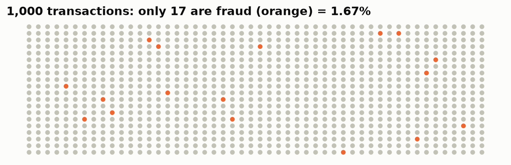

Only **1.67%** of transactions are fraud, about 1 in 60. This is an **imbalanced** problem (C1).

> **Explain like I'm 5:** You're looking for the red marbles in a jar where only 1 in 60 marbles is red. If you just say "every marble is blue", you're right 59 times out of 60, a 98% score! But you never found a red marble, so you're useless.

So **accuracy is a terrible score here**: "never fraud" is 98.3% accurate and catches nothing. We need scores that reward *finding* fraud: ROC AUC (the competition's metric) and PR-AUC (see C2).

---

## 3. How we are scored: AUC

The competition says: *"Submissions are evaluated on area under the ROC curve between the predicted probability and the observed target."*

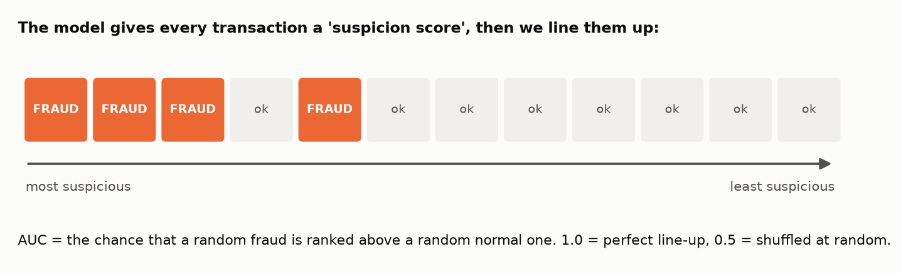

Sort every transaction from most to least suspicious. **AUC is the chance that a randomly picked fraud is ranked above a randomly picked normal transaction.** 1.0 = perfect, 0.5 = random shuffling. Only the **order** matters, not the exact numbers. Full details in C2.

---

## 4. Setting up

**Option A: Kaggle Notebook** (no install): on the competition page click **Code → New Notebook**. The data is at `/kaggle/input/playground-series-s6e11/`.

**Option B: your own computer:**

```bash
python -m pip install pandas scikit-learn lightgbm xgboost catboost imbalanced-learn matplotlib
```

Click **Join Competition** on Kaggle, download the data from the **Data** tab, and unzip:

```
Predicting Credit Card Fraud/
├── data/                     train.csv, test.csv, sample_submission.csv
├── common.py                 shared code: loading, features, cross-validation
├── v1_logistic_regression.py ... v8_imbalance.py   one script per version
├── tune_lightgbm.py          the settings search behind v4
├── analysis.py               feature importance, thresholds, AI scams, authentication
├── oof/                      saved predictions (created when scripts run)
├── submissions/              files to upload to Kaggle
└── results.csv               CV score of every version
```

Run scripts from inside the folder: `python v1_logistic_regression.py`. Run v1 to v6 before v7 (the ensemble reuses their predictions).

---

## 5. Looking at the data

Each row is one card payment with 24 clues (**features**, C1):

| Type | Columns |
|---|---|
| **Numbers** (13) | `amount_usd`, `hours_since_last_txn`, `txn_count_last_24h`, `distance_from_home_km`, `card_age_months`, `customer_age`, `account_balance_usd`, `cvv_retry_count`, `velocity_score`, `time_of_day_hour`, `day_of_week`, `merchant_risk_score`, `prior_disputes` |
| **Categories** (5) | `merchant_category` (Groceries, Gift Cards...), `card_type`, `auth_method` (PIN, OTP, No Authentication...), `channel`, `device_type` |
| **Yes/No flags** (6) | `is_foreign_transaction`, `is_new_merchant`, `used_vpn`, `ip_country_mismatch`, `billing_shipping_mismatch`, `is_ai_generated_scam_attempt` |

No missing values, so no gap-filling needed.


Every flag is a strong warning sign: an IP-country mismatch raises fraud from 1.4% to **16.5%**.


**No Authentication** → 6.4% fraud, **Biometric** → 0.5%. **Gift cards, crypto exchanges and gaming** are fraudsters' favourites, because they're easy to turn into cash.

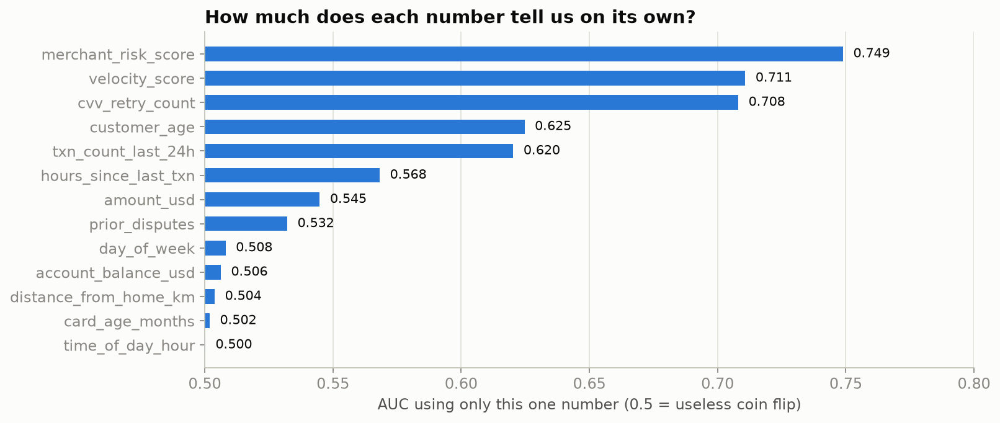

`merchant_risk_score`, `velocity_score` and `cvv_retry_count` are the strongest single numbers. `time_of_day_hour` tells us nothing on its own.

> **Explain like I'm 5:** A detective lists clues. "The thief typed the secret code wrong 3 times" is a great clue. "It happened on a Tuesday" isn't a clue at all.

---

# Part B: The journey

## 6. How we test every version fairly

Every version is scored with exactly the same **5-fold stratified cross-validation** (C4), using the same folds (`random_state=42`). The shared function `run_cv()` in `common.py`:

1. splits the training rows into 5 folds with the same 1.67% fraud rate in each;
2. trains on 4 folds and predicts the 5th, five times over, so every row gets an **out-of-fold (OOF)** prediction from a model that never saw it;
3. reports the **CV AUC** of all OOF predictions;
4. averages the 5 fold-models' predictions on the test set for the submission.

```python
skf = StratifiedKFold(n_splits=5, shuffle=True, random_state=42)
oof = np.zeros(len(X))
for train_idx, valid_idx in skf.split(X, y):
    p_valid, p_test = fit_predict(X.iloc[train_idx], y[train_idx], X.iloc[valid_idx], y[valid_idx], X_test)
    oof[valid_idx] = p_valid
print("CV AUC:", roc_auc_score(y, oof))
```

**Is an improvement real?** Fold AUCs vary by about ±0.003 (the noise). But because every version uses the *same* folds, we can compare them fold by fold. **A version that wins in all 5 folds is genuinely better**, even when the gain is small.


---

## 7. v1: Logistic regression (the baseline)

**File:** `v1_logistic_regression.py` | **CV AUC: 0.94187**

**What:** a **logistic regression** (C5). It gives each clue a weight, adds them up, and squashes the total into a probability with the **sigmoid** curve.

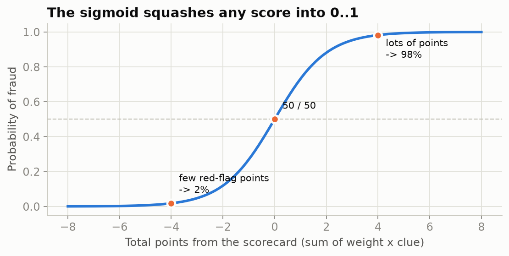

**Why start here:** always start simple (a **baseline**). It shows what "good" looks like, it's fast (11 seconds), and it catches bugs early.

**Preparation it needs:** **one-hot encoding** for the categories and **standard scaling** for the numbers (C3).

```python
pre = ColumnTransformer([("num", StandardScaler(), NUMS + FLAGS),
                         ("cat", OneHotEncoder(handle_unknown="ignore"), CATS)])
model = make_pipeline(pre, LogisticRegression(max_iter=2000))
```

**Result: 0.94187.** Already very good: the red flags are so strong that a simple points system works well.

**Its limit:** it can only *add up* clues. It can't learn "this flag matters a lot *only when* the merchant is risky", or "velocity is dangerous only above 40".

---

## 8. v2: LightGBM (gradient-boosted trees)

**File:** `v2_lightgbm.py` | **CV AUC: 0.94519** | **vs v1: +0.0034, better in 5/5 folds ✅**

**What changed:** we switched from a scorecard to **gradient-boosted decision trees** with the **LightGBM** library (C5).

A **decision tree** asks yes/no questions. Here is a real two-level tree learned from our data:

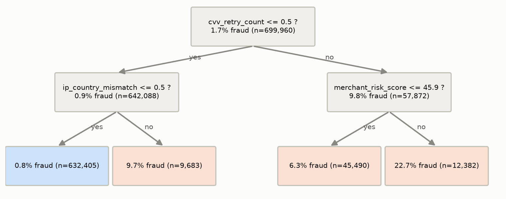

If nobody mistyped the CVV *and* there's no IP mismatch, fraud is only 0.8%. If the CVV was mistyped *and* the merchant is risky, it's **22.7%**. That's a *combination* of clues, which logistic regression can't express.

**Gradient boosting** builds hundreds of small trees one after another, each fixing the mistakes of the ones before.

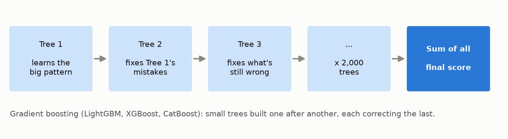

**Why it should be better:** trees learn **combinations** and **thresholds** automatically. They also need no scaling, and LightGBM reads text categories directly when marked as `category` type.

```python
model = lgb.LGBMClassifier(objective="binary", learning_rate=0.05, n_estimators=5000, num_leaves=31)
model.fit(X_tr, y_tr, eval_set=[(X_va, y_va)], eval_metric="auc",
          callbacks=[lgb.early_stopping(200)])
```

**Early stopping** (C6) stopped training after only ~200 to 400 trees. Remember this: it's the clue for v4.

**Did it work? Yes:** 0.94187 → 0.94519, winning all 5 folds.

---

## 9. v3: Adding new features

**File:** `v3_lightgbm_features.py` | **CV AUC: 0.94522** | **vs v2: +0.0000, better in 3/5 folds ❌**

**What changed:** same model, plus 13 hand-made clues (**feature engineering**, C3):

| New clue | Idea |
|---|---|
| `flag_count` | How many red flags at once |
| `amount_to_balance` | Spending a big share of the balance? |
| `amount_vs_category` | Unusually big for this type of shop? |
| `is_night` | Midnight to 6 am |
| `risk_x_velocity` | Risky shop AND card used rapidly |
| `no_auth`, `weak_auth_risky` | No authentication, alone and combined with flags |
| `txn_per_hour` | A velocity feature: transactions in 24h ÷ hours since the last one |
| `*_freq` (4 columns) | **Frequency encoding**: how common is this exact value? |

**Did it work? No.** The change was 0.00003, and it won only 3 of 5 folds (a coin flip).

**Why not?** Trees already build these combinations themselves (`flag_count` is just "flag A and flag B..."), and in this synthetic data the signal sits in the individual columns.

**Lesson:** a feature that *sounds* smart isn't automatically useful. **Measure it.** We **dropped** these features and went back to the raw 24 columns.

---

## 10. v4: Tuning LightGBM (slow and steady)

**File:** `v4_lightgbm_tuned.py` | **CV AUC: 0.94737** | **vs v2: +0.0022, better in 5/5 folds ✅**

**The clue from v2:** it stopped after ~300 trees because it started **overfitting** (C6), memorising the training data and getting worse on new data:

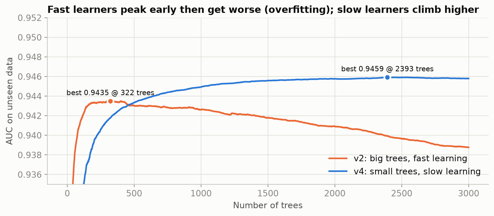

The orange line (v2) peaks early and then falls. The blue line (v4) climbs slowly but goes higher.

**What changed:** the **hyperparameters** (C6), all in the direction of **regularisation**, meaning "don't trust any single pattern too much":

| Setting | v2 | v4 | Why |
|---|---|---|---|
| `learning_rate` | 0.05 | **0.02** | Smaller correction per tree, so more careful learning |
| `max_depth` | unlimited | **4** | Smaller trees, simpler rules |
| `min_child_samples` | 20 | **300** | A rule must cover at least 300 transactions |
| `colsample_bytree` | 1.0 | **0.4** | Each tree sees a random 40% of the columns |
| `subsample` | 1.0 | **0.7** | Each tree sees a random 70% of the rows |
| `reg_lambda` | 0 | **10** | L2 penalty on extreme leaf values |
| `cat_smooth` | 10 | **50** | Smoother handling of rare categories |

We tested three settings in `tune_lightgbm.py`. All scored about 0.9473, and the depth-limited one was best.

**Did it work? Yes:** 0.94519 → 0.94737, winning all 5 folds. It now uses ~2,000 small, careful trees instead of ~300 big ones.

---

## 11. v5: XGBoost

**File:** `v5_xgboost.py` | **CV AUC: 0.94712** | **vs v4: -0.0002, better in 0/5 folds ❌ (but useful in v7)**

**What changed:** **XGBoost** (C5), another boosting library. It grows trees level by level instead of leaf by leaf, and handles categories differently. Same "slow and steady" settings.

**Did it work?** Slightly worse on its own. We kept it anyway because **a different model makes different mistakes**, and an ensemble needs exactly that.

---

## 12. v6: CatBoost

**File:** `v6_catboost.py` | **CV AUC: 0.94619** | **vs v4: -0.0012, better in 0/5 folds ❌ (but useful in v7)**

**What changed:** **CatBoost** (C5), a booster designed for categories. It uses **ordered target statistics** and **symmetric trees**.

**Did it work?** Weaker alone and slow (29 minutes vs 3). Our categories have only 5 to 12 values, so CatBoost's special category handling has little to offer. It is, however, the most *different* of the three boosters.

---

## 13. v7: Ensemble

**File:** `v7_ensemble.py` | **CV AUC: 0.94744** | **vs v4: +0.0001, better in 5/5 folds ✅**

**What changed:** we combined v4, v5, v6 and v1 into one prediction (an **ensemble**, C9):

1. **Rank** each model's predictions (scaled to 0..1), because the models' probabilities are on different scales and AUC only cares about order.
2. **Search for the best weights** on the OOF predictions with `scipy.optimize.minimize`.

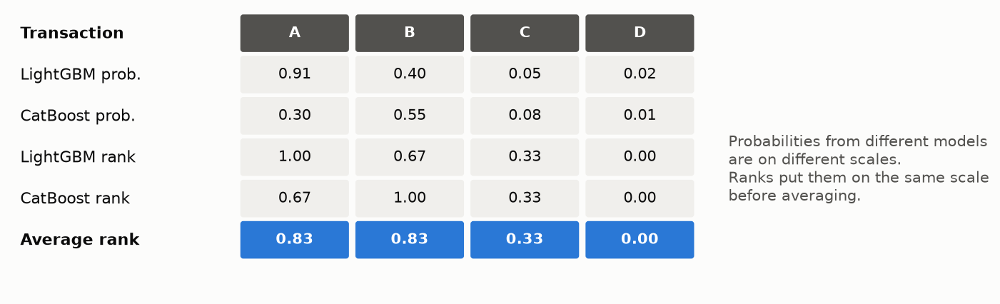

| Model | Weight |
|---|---|
| v4 LightGBM | 0.63 |
| v5 XGBoost | 0.24 |
| v6 CatBoost | 0.12 |
| v1 Logistic regression | 0.01 |

An *equal* average scored only 0.94702, worse than v4 alone, because the weak model got a quarter of the vote. **Weights matter.**

**Why the gain is small:**


The three boosters rank transactions **98.5% to 99.5% the same**. Blending only helps where models disagree.

**Did it work? Yes, a little:** +0.00008, but in all 5 folds, so the gain is real. **This is our best model.**

---

## 14. v8: Imbalance techniques (class weights, undersampling, SMOTE)

**File:** `v8_imbalance.py` | results in `v8_imbalance_results.csv`

**The question** (straight from the original dataset's description): *"Compare SMOTE, class weights and undersampling on the same model."* Fraud is only 1.67% of the data. Would the model learn better if we made fraud "louder"?

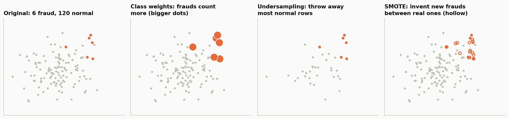

We tried four techniques (all explained in C7), each on the v4 LightGBM with the same folds:

| Technique | What it does | ROC AUC | PR-AUC |
|---|---|---|---|
| **Nothing** (v4) | Train on the data as it is | **0.94737** | **0.5137** |
| Class weights ×59 | Each fraud counts like 59 normal rows | 0.94641 | 0.5067 |
| Soft class weights ×7.7 | Each fraud counts like ~8 rows | 0.94728 | 0.5127 |
| Undersampling 1:10 | Keep all frauds and only 10 normal rows per fraud (5× less data) | 0.94678 | 0.5103 |
| SMOTE-NC | Invent synthetic frauds until they're 10% of the normals | 0.91607 | 0.3319 |

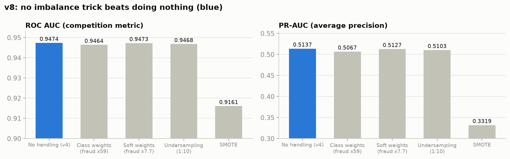

**Result: none of them beats doing nothing.** Why?

- **AUC only cares about order.** Class weights mostly push *all* probabilities up. The ranking barely changes, so AUC can't improve, and the extra weight makes the model a bit noisier.
- **We have plenty of fraud.** 11,689 fraud examples is a lot. Imbalance tricks matter most when you have only a few hundred, like the original 20,000-row dataset (339 frauds).
- **Undersampling throws away information.** It's 5× faster to train and nearly as good, which is useful for quick experiments, but not better.
- **SMOTE hurts badly here.** It invents frauds by drawing lines between real ones. With many yes/no flags and categories, those in-between points describe transactions that don't really exist, and the model learns from fake patterns.

**A bug we found and fixed (an important lesson):** the first run gave class weights an AUC of only 0.840. The cause: LightGBM's early stopping watches *every* metric by default, including log-loss. With class weights, the plain log-loss on the validation fold gets worse from the very first trees, even while AUC improves, so training stopped almost immediately. The fix was to make AUC the only metric watched (`metric="auc"`). **When a result looks shocking, suspect your setup before believing it.**

**Verdict:** not kept. v7 stays the best model. (For the leaderboard metric, which is AUC, "do nothing" wins.)

---

# Part B2: Breaking the plateau (v9 to v23)

After v8, every model had landed between 0.942 and 0.947, which looked like a wall. This part covers how we found out *why*, and the ideas that got past it, step by step.

## B2.1 Diagnosing the wall: is 0.96 even possible?

**File:** `diagnostics.py`, report in `DIAGNOSTICS_REPORT.md`

Before trying more models, we checked whether better scores were even possible. Four checks:

1. **Calibration.** We grouped transactions into 20 bins by predicted probability and compared the average prediction with the real fraud rate in each bin. They matched almost perfectly (overall 1.66% predicted vs 1.67% real). The model's probabilities are honest.
2. **Simulated ceiling.** If those probabilities were the *true* chance of fraud, what AUC could a perfect model get? We simulated it: flip a weighted coin for every row using its probability as the coin's bias, then score the model against those fake answers. The result was about **0.944**, *below* our real 0.947. So at the level of detail the model could see, it was already at the ceiling.
3. **Missed frauds.** Only 1.4% of frauds were in the bottom half of the model's scores, and they looked completely clean: no red flags, low risk. They were random "noise" frauds that no model could catch.
4. **Generator fingerprints.** Exact values behaved strangely. `velocity_score = 0` is almost never fraud (0.04%, against 0.35% for nearby values), and some exact values of `hours_since_last_txn` and `customer_age` had their own fraud rates.

> **Explain like I'm 5:** Before practising harder for a test, check whether the test is even fair. If some answers are random coin flips, nobody can get 100%. We found the coin flips. We also found that the person who wrote the test left tiny pencil marks on some questions, and those marks give hints.

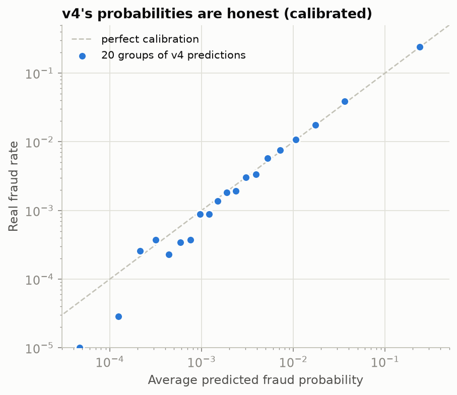

**Conclusion:** the only way up was **new information**, not better tuning. That information turned out to be in those *exact-value fingerprints* left by the data generator.

## B2.2 v9: Per-value fraud scores (Weight of Evidence)

**File:** `v9_lightgbm_woe.py` (features in `fe_v9.py`) | **CV AUC: 0.94855** | **vs v4: +0.0012, better in 5/5 folds ✅**

**What changed:** for 7 numeric columns, every *exact value* gets its own smoothed fraud score, the **Weight of Evidence (WoE)** (C11). Three extras:
- The `merchant_risk_score` and `velocity_score` scores are made "residual": the general trend is subtracted, so only the value-specific spikes remain.
- A summed score (`woe_memo_sum`) adds up the sparse columns' scores.
- Value-frequency features, the `velocity_score = 0` flag, and **finer histogram bins** (`max_bin = 1023`) let the trees see exact values.

**Why it should help:** the diagnostics showed exact values carry signal. The scores are computed **inside each fold**, with an inner 5-fold split for the training rows, so no row ever sees its own answer.

**Did it work? Yes:** a first real feature gain. The screen showed which parts mattered:

| Change (fast screen) | CV AUC |
|---|---|
| base | 0.94716 |
| finer bins only | 0.94751 |
| + per-value scores (smoothing 40) | **0.94842** |
| dropping "noise" columns | 0.94820 (worse, so we kept them) |
| + pair scores | 0.94829 (no help) |

## B2.3 v10: Spline scorecard

**File:** `v10_spline_logreg.py` | **CV AUC: 0.94721** | **vs v1: +0.0053, better in 5/5 folds ✅**

**What changed:** the v1 scorecard got curves instead of straight lines (**splines**, C11) and exact-age categories. It also got the zero-velocity flag, the v9 scores, and authentication interactions.

**Why:** the diagnostics showed the risk curves bend (age jumps at 34, velocity accelerates above 33), and a straight line can't bend.

**Result:** a *linear* model nearly matching the trees, and it thinks differently from them. That diversity is what helps an ensemble later.

## B2.4 v11: Explainable Boosting Machine (EBM)

**File:** `v11_ebm.py` | **CV AUC: 0.94927** | **vs v9: +0.0007, better in 5/5 folds ✅**

**What changed:** a new kind of model, an **EBM** (C11). It learns one fine-grained step curve per feature, adds them up, and allows only a few 2-feature interactions.

**Why it won:** the data generator seems to have built fraud mostly as a *sum* of separate effects. Deep trees waste effort on 3- and 4-way interactions that don't exist, while the EBM's shape matches the problem. A bigger EBM (v11b, more bags and interactions) scored 0.94919, so it was not better.

## B2.5 v12 to v14: The old boosters with the new features

| Version | Model | CV AUC | vs old version |
|---|---|---|---|
| v12 | XGBoost + v9 features | 0.94847 | +0.0014 vs v5 |
| v13 | CatBoost + v9 features, depth 4 | 0.94780 | +0.0016 vs v6 |
| v14 | LightGBM extra-trees | 0.94758 | weaker, near-zero blend weight |

The same features lifted every model family, which confirms the signal is real.

## B2.6 v15: First leak-free stack

**File:** `v15_stack.py` | **CV AUC: 0.94941**

A small logistic regression (**stacking**, C11) learns how much to trust each of v9 to v14. It is trained on 4 folds' predictions and scored on the 5th, so the score is honest. The EBM got the biggest weight. Gain over the EBM alone: +0.00014.

## B2.7 v16 to v18: Digit keys and the "GLM-boost" trick

**File:** `v16_glm_boost.py`, features in `fe_keys.py` | **v16 CV AUC: 0.95121** | **vs v11: +0.0019, better in 5/5 folds ✅**

This was the biggest single jump of the whole project. Two ideas:

**1. Digit keys.** The generator seems to have written numbers digit by digit, and individual digits carry fraud signal. For each decimal column we made 6 "keys": the integer part, the tens, the tenths, the cents, the first digit and the first two digits. On their own, the cents of `hours_since_last_txn` score AUC 0.566, and the first two digits of `amount_usd` score 0.588, against 0.545 for the raw amount. Together with 24 exact-value keys and 13 pair keys, that makes **73 keys**, each target-encoded inside the folds with a fast `np.bincount` method (6 seconds per fold).

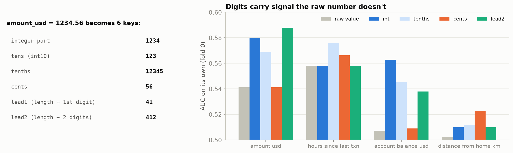

**2. GLM-boost.** A logistic regression (a **GLM**, C11) on all 73 encoded keys already scores **0.95058** on its own. Its output then becomes the *starting point* (`init_score`) for a LightGBM with **only 4 leaves per tree**. The trees spend all their effort fixing the GLM's remaining mistakes instead of rebuilding what it already knows.

> **Explain like I'm 5:** A good student writes the first draft of an essay, then a careful editor fixes only the small mistakes. That works far better than asking the editor to write the whole essay from scratch.

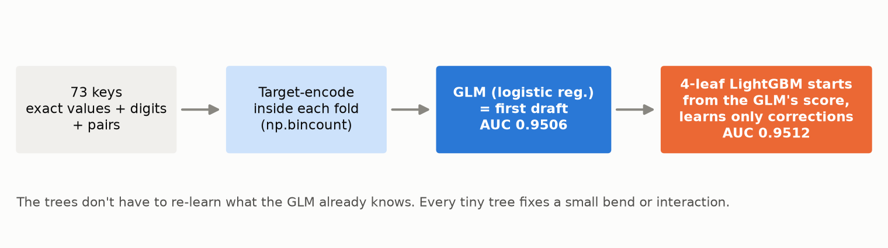

| Version | What | CV AUC |
|---|---|---|
| GLM alone | logistic regression on 73 encoded keys | 0.95058 |
| v16 | GLM + 4-leaf LightGBM, 3 seeds, full refit | 0.95121 |
| v17 | the same with **10 folds** (encodings learn from 90% of labels), 2 seeds | **0.95149** (best single) |
| v18 | GLM + depth-2 XGBoost | 0.95111 |

## B2.8 v19 to v22: More diversity

| Version | Model | CV AUC | Role |
|---|---|---|---|
| v19 | one big sparse logistic regression with 62,172 one-hot columns (every exact value and digit) | 0.95011 | strong, different linear view |
| v20 | EBM on raw columns + digit encodings | 0.94995 | additive view |
| v21 | scikit-learn neural network, 3 seeds | 0.94259 | weak and unstable |
| v22 | 4-leaf LightGBM on raw columns only (no encodings) | 0.94827 | "anchor" with no encodings at all |

v22 is worth noting: tiny 4-leaf trees on raw data beat the carefully tuned 16-leaf v4 (0.94737). Shallow trees suit this data.

## B2.9 v23: Final stack and the zero-fraud zones

**File:** `v23_stack.py` | **CV AUC: 0.95156**

**What changed from v15:**
1. Every model's predictions are converted to **rank-logits** (C11) before stacking, so models with different output scales are treated fairly.
2. Four ways of combining are compared, each scored on **3 different fold splits** (seeds 43, 44, 45) that the base models never used: logistic regression with strong smoothing (C=0.01), with weaker smoothing (C=0.05), hill climbing, and a 50/50 mix. The best was **logistic regression with C=0.05 (0.95156), with the 50/50 mix a close second (0.95154)**.
3. **Zero-fraud zones:** no training fraud ever had `merchant_risk_score < 13.1`, or `velocity_score ≤ 4.1` together with `merchant_risk_score ≤ 20`. Pushing those rows to the bottom of the ranking helped in **all 5 folds** (checked using only training-fold information). It's a tiny gain (+0.00002), so we kept it.

**Final result: 0.95156**, up from 0.94744 (v7) and 0.94941 (v15).

**An honest note:** the final stack is only +0.00007 better than v17 alone (0.95149). Hill climbing even chose v17 by itself. Once one model is very strong, blending adds little. Adding v20 to the stack changed nothing (0.95155), so the final stack uses 8 models.

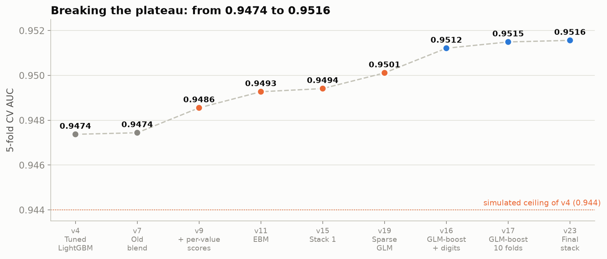

---

# Part B (continued)

## 15. The whole journey on one page


| Version | What changed | CV AUC | vs best before | Kept? |
|---|---|---|---|---|
| v1 | Logistic regression | 0.94187 | baseline | baseline |
| v2 | Gradient-boosted trees (LightGBM) | 0.94519 | **+0.0033** (5/5 folds) | ✅ |
| v3 | + 13 engineered features | 0.94522 | +0.0000 (3/5) | ❌ |
| v4 | Regularised LightGBM | 0.94737 | **+0.0022** (5/5) | ✅ |
| v5 | XGBoost | 0.94712 | -0.0002 | in blend |
| v6 | CatBoost | 0.94619 | -0.0012 | in blend |
| v7 | Weighted rank blend | 0.94744 | +0.0001 (5/5) | ✅ |
| v8 | Class weights / undersampling / SMOTE | 0.916 to 0.9473 | no gain | ❌ |
| v9 | + per-value fraud scores (WoE), finer bins | 0.94855 | **+0.0011** vs v7 (5/5) | ✅ |
| v10 | Spline scorecard | 0.94721 | -0.0013 | in blend |
| v11 | EBM (additive model) | 0.94927 | **+0.0007** (5/5) | ✅ |
| v12 to v14 | XGBoost / CatBoost / extra-trees + new features | 0.94758 to 0.94847 | below v11 | in blend |
| v15 | First leak-free stack | 0.94941 | +0.0001 | ✅ |
| v16 | Digit keys + GLM + 4-leaf LightGBM | 0.95121 | **+0.0018** (5/5) | ✅ |
| v17 | Same, 10 folds | 0.95149 | +0.0003 | ✅ best single |
| v18 to v22 | XGBoost GLM-boost, sparse GLM, EBM + digits, neural net, raw 4-leaf | 0.94259 to 0.95111 | below v17 | in blend |
| v23 | Final rank-logit stack + zero-fraud zones | **0.95156** | +0.00007 | ✅ **best** |

**Four big lessons**

1. **Start simple.** The baseline was 0.942. Everything after it added 0.005.
2. **Measure everything.** Smart-sounding features (v3) and popular imbalance tricks (v8) did nothing or hurt. A boring settings change (v4) gave the biggest gain after switching to trees.
3. **Small, consistent gains are real.** With shared folds, winning 5 out of 5 proves a gain even when it's tiny.
4. **When you hit a wall, diagnose before tuning.** The simulated ceiling showed tuning was pointless. The real gains (+0.004) came from *new information*: exact values and digits that the data generator left behind.

---

## 16. Four questions answered with the model

These come from the original dataset's description. Code: `analysis.py`, numbers in `analysis_results.txt`.

### Q1. Which signals catch the most fraud?

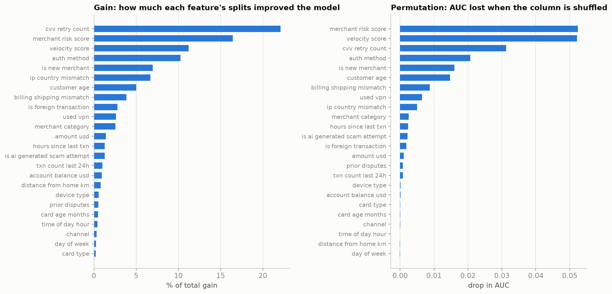

Two ways of measuring importance (C8) agree on the **top 3: `merchant_risk_score`, `velocity_score` and `cvv_retry_count`**, followed by `auth_method`. Shuffling `merchant_risk_score` costs the model **0.052 AUC**. Shuffling `day_of_week`, `distance_from_home_km` or `time_of_day_hour` costs nothing: the model ignores them.

> **Explain like I'm 5:** To find out which clue a detective needs most, hide one clue at a time and see how much worse they get. Hiding "the shop is dodgy" hurts a lot. Hiding "what day it was" doesn't hurt at all.

### Q2. Precision, recall and threshold tuning: how much recall can you buy per false alarm?

A bank can't call every customer, so it must choose a **threshold** (C2): flag everything above a certain suspicion score.

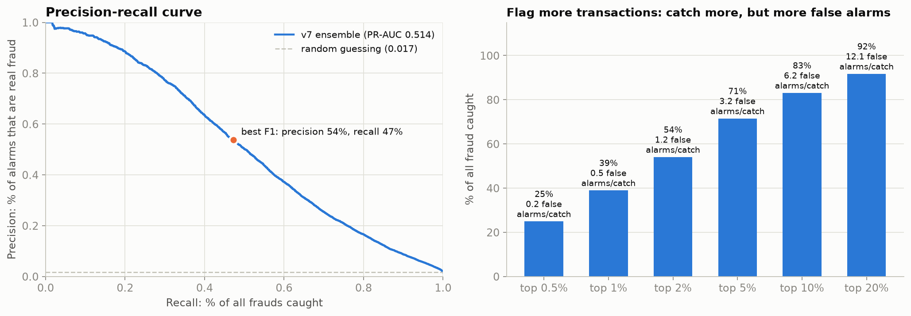

| Flag the top... | Recall (fraud caught) | Precision (alarms that are real) | False alarms per fraud caught |
|---|---|---|---|
| 0.5% | 24.9% | 83.2% | 0.2 |
| 1% | 38.9% | 65.0% | 0.5 |
| 2% | 54.0% | 45.1% | 1.2 |
| 5% | 71.5% | 23.9% | 3.2 |
| 10% | 83.1% | 13.9% | 6.2 |
| 20% | 91.7% | 7.7% | 12.1 |

Catching the first quarter of fraud is almost free (1 false alarm per 5 catches). Catching 90% costs 12 false alarms per catch. The **best F1** point flags about the top 1.5%: precision 54%, recall 47%.

Here is the confusion matrix when flagging the top 2%:

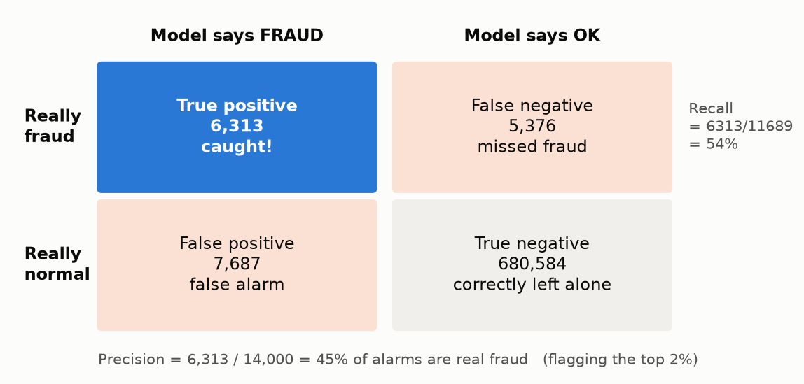

**PR-AUC = 0.514**, against 0.017 for random guessing (30× better). The dataset's author recommends PR-AUC because it focuses on the rare fraud class. Our ROC AUC of 0.947 sounds near-perfect, but PR-AUC reminds us that at most thresholds a large share of alarms are still false.

### Q3. Are AI-generated scam attempts harder to catch?

**No, they're easier.** 93.1% of AI-scam frauds land in the model's top 5% most suspicious, against 70.8% of other frauds. AI-scam attempts are fraud 15.2% of the time (vs 1.6% for everything else), and they tend to come with other red flags, so they stand out.

### Q4. Does strong authentication actually suppress fraud?

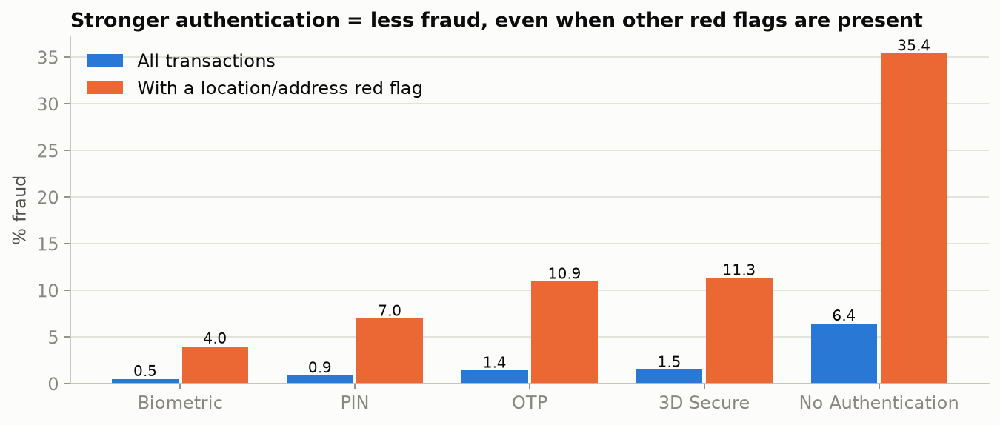

**Yes.** Biometric (0.5%) < PIN (0.9%) < OTP (1.4%) ≈ 3D Secure (1.5%) < **No Authentication (6.4%)**. The ordering holds **even among transactions that already have a location or address red flag** (4.0% with biometrics vs 35.4% with no authentication), so it's not just that safer customers use biometrics. Strong authentication works. (In synthetic data this reflects how the data was generated, but the lesson matches the real world.)

---

## 17. Submitting to Kaggle

Every script writes `submissions/<version>.csv` in the required format (299,984 rows, columns `id,is_fraud`).

Upload **`v23_stack.csv`** first (best CV), then `v17_glm_lgb10.csv` to compare. Short descriptions:

- v23: *"Rank-logit stack of GLM-boosted LightGBM/XGB + sparse GLM + EBM (CV AUC 0.95156)"*
- v17: *"Digit keys + GLM + 4-leaf LightGBM, 10-fold (CV AUC 0.95149)"*

The public leaderboard scores only part of the test set (C10), so trust CV over small leaderboard differences.

---

# Part C: Terms and techniques

Each entry has: **Explain like I'm 5** → **what it is / how it works** → **why we used it** → **key settings or pitfalls**.

## C1. The problem

### Feature
> **Explain like I'm 5:** A clue. "The card was used abroad" is a clue.

A **feature** is one input column the model uses to make its guess. Here there are 24 (amount, velocity score, flags...). By convention all the features together are called **`X`**.

### Target (label)
> **Explain like I'm 5:** The answer on the back of the card: "fraud" or "not fraud".

The column we want to predict, `is_fraud`. Called **`y`**. In training data we know it; in test data it's hidden.

### Binary classification
> **Explain like I'm 5:** A game with exactly two answers: yes or no.

Predicting one of two classes (fraud = 1, normal = 0). Most models output a **probability** for class 1 rather than a hard yes/no.

### Probability
> **Explain like I'm 5:** How sure you are. 0.9 means "I'm almost sure it's fraud", 0.1 means "probably fine".

A number between 0 and 1. Kaggle wants probabilities because ROC AUC needs a ranking: with only 0/1 answers, you can't say which of two flagged transactions is *more* suspicious.

### Imbalanced data
> **Explain like I'm 5:** A jar with 59 blue marbles for every red one.

One class is much rarer than the other (1.67% fraud). Consequences: accuracy becomes misleading, the rare class gives the model fewer examples to learn from, and metrics like PR-AUC and precision/recall become important. Techniques to deal with it are in C7.

---

## C2. Measuring success

### Accuracy (and why it's misleading here)
> **Explain like I'm 5:** The percentage of answers you got right. But if you say "blue" for every marble, you're 98% right and still never found a red one.

Accuracy = correct predictions ÷ all predictions. With 1.67% fraud, predicting "never fraud" gives 98.3% accuracy. That's useless, which is why we never use accuracy in this project.

### Confusion matrix (TP, FP, FN, TN)
> **Explain like I'm 5:** A 2×2 box that sorts the guard's decisions: thieves caught, innocent people stopped by mistake, thieves who got away, and innocent people correctly let through.

Once you pick a threshold, every transaction falls into one of four boxes:

| | Model says fraud | Model says OK |
|---|---|---|
| **Really fraud** | **True positive (TP)**: caught | **False negative (FN)**: missed |
| **Really normal** | **False positive (FP)**: false alarm | **True negative (TN)**: correctly ignored |

Every other metric below is built from these four counts. See the real one in section 16.

### Precision
> **Explain like I'm 5:** Of all the people the guard stopped, how many were really thieves?

Precision = TP ÷ (TP + FP). High precision = few false alarms. Matters when each alarm is expensive (a phone call, an annoyed customer).

### Recall (sensitivity, true positive rate)
> **Explain like I'm 5:** Of all the thieves in the shop, how many did the guard catch?

Recall = TP ÷ (TP + FN). High recall = little fraud slips through. Matters when missing fraud is expensive.

**Precision and recall pull against each other:** flag more transactions and recall goes up but precision goes down (section 16).

### F1 score
> **Explain like I'm 5:** One grade that's only high if the guard is good at *both* catching thieves and not stopping innocent people.

F1 = 2 × precision × recall ÷ (precision + recall), the *harmonic mean*. It punishes being bad at either one. We used it to find a balanced threshold.

### Threshold
> **Explain like I'm 5:** The line on the suspicion meter. Above the line, the guard stops you.

The cut-off that turns a probability into a decision ("flag if score ≥ 0.3"). It doesn't change the model, only how you *use* it. **Threshold tuning** means choosing the cut-off that best fits the business: how many false alarms you can afford per fraud caught. ROC AUC and PR-AUC summarise the model over **all** thresholds at once, which is why the competition doesn't need you to pick one.

### ROC curve and ROC AUC
> **Explain like I'm 5:** Line up everyone from "most suspicious" to "least suspicious". AUC asks: if I pick one thief and one innocent person, how often is the thief standing closer to the front?

**How it works:**
- For every possible threshold, compute the **true positive rate** (recall) and the **false positive rate** (FP ÷ all normals).
- Plotting one against the other gives the **ROC curve** (Receiver Operating Characteristic, a name from World War II radar). A perfect model hugs the top-left corner; random guessing is the diagonal.
- The **area under the curve (AUC)** equals the probability that a random fraud gets a higher score than a random normal transaction.

**Key facts:**
- 1.0 = perfect, 0.5 = random.
- It depends **only on the order** of the predictions. Multiplying every prediction by 2, or converting predictions to ranks, gives exactly the same AUC. We exploit this in the ensemble.
- It is **insensitive to imbalance**, which is good for comparing models, but it can look flattering: 0.947 sounds near-perfect even though many alarms are still false.

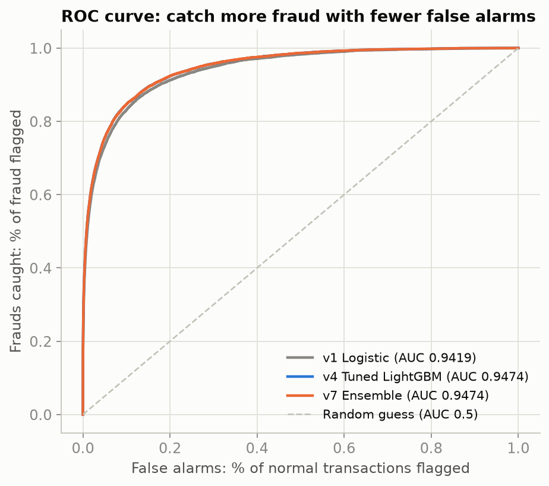

### PR curve and PR-AUC (average precision)
> **Explain like I'm 5:** Instead of asking about everyone, only ask about the thieves: as the guard tries to catch more of them, how many innocent people does he stop by mistake?

**How it works:** plot **precision** (y) against **recall** (x) for every threshold. The area under it is **PR-AUC**, usually computed as **average precision** (`sklearn.metrics.average_precision_score`).

**Why it matters for fraud:** a random model's PR-AUC equals the fraud rate (0.017), not 0.5. So PR-AUC shows how much better than chance you really are *on the rare class*. Ours is 0.514 (30× better than chance). It's the metric the original dataset's author recommends. ROC AUC is still what Kaggle scores, so we optimise ROC AUC and report PR-AUC alongside.

---

## C3. Preparing data

### One-hot encoding
> **Explain like I'm 5:** A computer can't read "Gift Cards". So we give each shop type its own light switch: the Gift Cards switch is ON (1), all the others are OFF (0).

Turns a category column with *k* values into *k* columns of 0/1 (`OneHotEncoder` or `pd.get_dummies`). **Why not just number the categories 1, 2, 3?** Because a model like logistic regression would think "Utilities (12)" is twelve times "Crypto (1)", which is meaningless. Used in v1. Tree models don't need it.

### Native categorical handling
> **Explain like I'm 5:** Some smart models can read the shop names themselves; you just tell them "this column is a list of names".

LightGBM, XGBoost and CatBoost can split directly on category values if the column has pandas `category` type. LightGBM, for example, sorts the categories by their fraud rate and finds the best way to split them into two groups. Faster, and often better than one-hot. Used in v2 to v8.

### Standard scaling
> **Explain like I'm 5:** One clue is measured in dollars (up to 99,701) and another in "number of wrong codes" (0 to 3). We change both to the same kind of ruler so the big numbers don't shout over the small ones.

Each number becomes (value − mean) ÷ standard deviation, so every column has mean 0 and spread 1 (`StandardScaler`). Needed for logistic regression (and SVMs, neural networks). Trees don't care, because a split like "amount > 200" works the same at any scale.

### Feature engineering
> **Explain like I'm 5:** Instead of giving the detective raw facts, you hand over ready-made hints: "this person had 3 red flags at once".

Creating new features from existing ones: ratios (`amount_to_balance`), counts (`flag_count`), interactions (`risk_x_velocity`), velocity features (`txn_per_hour`). Often the biggest win in real projects. Here it gave nothing (v3), because trees already found these patterns. **Always measure.**

### Frequency (count) encoding
> **Explain like I'm 5:** Count how many times each exact value appears. A value that shows up very often or very rarely might be a hint.

Replace a value with how often it occurs in train + test. A known trick for synthetic Playground data, because generators sometimes leave fingerprints in how often values repeat. It didn't help here.

### Target encoding (CatBoost's ordered target statistics)
> **Explain like I'm 5:** Replace "Gift Cards" with "7% of gift-card payments were fraud". But to be fair, for each row you may only use the rows that came *before* it, so you never peek at your own answer.

Each category is replaced by the fraud rate of that category. Done naively, it **leaks** (C4): a row's own label is included in its own encoding. CatBoost fixes this by processing rows in a random order and using only the rows *before* each one ("ordered" statistics). Used inside v6.

---

## C4. Testing honestly

### Training, validation and test sets
> **Explain like I'm 5:** Homework (training), a practice exam you mark yourself (validation), and the real exam where you never see the answers (test).

- **Training set:** what the model learns from.
- **Validation set:** held-out labelled data used to check the model and choose settings.
- **Test set:** Kaggle's hidden-label data. We only predict it.

Never judge a model on the data it trained on: it may have memorised it.

### K-fold cross-validation
> **Explain like I'm 5:** Five practice exams. Each time you study four chapters and get quizzed on the fifth. Your grade is the average of all five quizzes.

Split the data into K parts (here K = 5). Train on K−1 parts and validate on the remaining one; repeat K times. Every row is validated exactly once. It's more reliable than a single split because the score is averaged over five different validation sets, and it uses all the data for both training and checking.

### Stratification
> **Explain like I'm 5:** When you split a bag of sweets into five piles, make sure every pile gets its fair share of the rare red sweets.

`StratifiedKFold` makes every fold have the same 1.67% fraud rate. Without it, one fold might get 1.5% fraud and another 1.9%, making fold scores noisier.

### Out-of-fold (OOF) predictions
> **Explain like I'm 5:** For every practice question, you write down the answer you gave when that question was on your quiz, never when you'd already studied it.

Each training row's prediction comes from the fold-model that did **not** train on it. OOF predictions give an honest CV score, and they can be used to build ensembles without cheating (v7), because no model ever predicts rows it trained on.

### CV noise and paired comparison
> **Explain like I'm 5:** If you score 84 on one quiz and 85 on the next, did you really get smarter, or was the second quiz just a bit easier? Compare yourself with a friend on *the same* quizzes to find out.

Fold scores vary by about ±0.003 just from which rows land in which fold. A difference smaller than that might be luck. But if two versions are tested on **identical folds** and one wins on every fold, the win is real (a *paired* comparison). That's how we judged every iteration.

### Data leakage
> **Explain like I'm 5:** Accidentally seeing the answers before the test. Your score looks amazing, but it's a lie.

Any way information about the validation labels sneaks into training. Examples: target-encoding with a row's own label, resampling (SMOTE) *before* splitting into folds so that synthetic copies of validation frauds end up in training, or choosing features by looking at the whole dataset's labels. Our rule: **anything that uses labels happens inside each fold, on the training part only.** v8 resamples inside each fold for exactly this reason.

### Random seed
> **Explain like I'm 5:** A magic number that makes the "random" coin flips come out the same every time, so you can repeat your experiment.

`random_state=42` fixes the folds, the row/column sampling and the SMOTE choices, so results are reproducible and versions are compared on the same folds.

---

## C5. The models

### Baseline
> **Explain like I'm 5:** Your first, simple attempt, so you know what "better" means.

The simplest reasonable model. Every later version must beat it. Ours: logistic regression, AUC 0.94187.

### Logistic regression
> **Explain like I'm 5:** A scorecard. "Foreign transaction: +2 points. Fingerprint used: −3 points." Add up the points. Lots of points = suspicious.

**How it works:**
1. Each feature gets a **weight** (coefficient).
2. The model computes a score: z = bias + w₁·x₁ + w₂·x₂ + ...
3. The **sigmoid** function, p = 1 ÷ (1 + e^(−z)), squashes z into a probability between 0 and 1 (see the chart in section 7).
4. Training finds the weights that make the predicted probabilities match the real labels as closely as possible (minimising **log-loss**).

**Key settings:** `C` = inverse regularisation strength (smaller C = weights pushed closer to zero = simpler model). `max_iter` = how long the optimiser may run.

**Strengths:** fast, simple, interpretable (you can read the weights). **Weakness:** it only *adds* effects, so it can't learn "A matters only when B" unless you build that feature yourself.

### Log-loss (binary cross-entropy)
> **Explain like I'm 5:** A penalty for being confidently wrong. Saying "99% sure it's fine" about a fraud costs you a lot; saying "60% sure" costs a little.

loss = −[y·log(p) + (1−y)·log(1−p)], averaged over rows. It's what most classifiers minimise during training (LightGBM's `objective="binary"`). It's also LightGBM's default validation metric, which caused the early-stopping bug in v8.

### Decision tree
> **Explain like I'm 5:** The game "20 Questions". "Did they type the code wrong?" Yes. "Is the shop risky?" Yes. "Then I'm suspicious!"

**How it works:**
1. Start with all rows. Try every feature and every possible split point ("cvv_retry_count ≤ 0.5?").
2. Pick the split that best separates fraud from normal (measured by how much it reduces log-loss or *Gini impurity*).
3. Repeat inside each branch until a stopping rule (maximum depth, minimum rows per leaf).
4. Each final box (**leaf**) predicts the fraud rate of its training rows.

See the real tree in section 8. **Strengths:** learns thresholds and combinations, needs no scaling. **Weakness:** one deep tree overfits easily, so we use many small ones (boosting).

### Gradient boosting
> **Explain like I'm 5:** The first student answers the quiz and gets some wrong. The second student studies only the questions the first got wrong. The third studies what's *still* wrong. Add all their answers together and the team gets almost everything right.

**How it works:**
1. Start with a simple guess (the average fraud rate).
2. Compute how wrong each row is: the **gradient** of the loss, roughly "how much and in which direction should this row's score move?"
3. Fit a small tree that predicts those corrections.
4. Add that tree's output to the running score, multiplied by the **learning rate** (e.g. 0.02), so each tree only nudges.
5. Repeat hundreds or thousands of times.

**Key settings:** `n_estimators` (number of trees), `learning_rate` (size of each nudge), tree size (`max_depth`, `num_leaves`), and the regularisation settings in C6. Lower learning rate + more trees usually = better but slower. Gradient boosting is the most successful method for table-shaped data like this.

### LightGBM
> **Explain like I'm 5:** A super-fast boosting machine that grows each tree where it's most needed first.

Microsoft's gradient boosting library. Two tricks make it fast:
- **Histogram binning:** it groups each feature's values into ~255 buckets, so it tries 255 split points instead of millions.
- **Leaf-wise growth:** it always splits the leaf that reduces the loss most, so trees can be lopsided. That's powerful but can overfit, which is why `num_leaves`, `max_depth` and `min_child_samples` matter.

It handles categories natively. Our main model (v2, v4).

### XGBoost
> **Explain like I'm 5:** An older, very famous boosting machine that grows its trees one whole level at a time, like building a pyramid floor by floor.

"eXtreme Gradient Boosting" made boosting famous on Kaggle around 2015. It grows trees **level-wise** (depth by depth) by default, uses built-in L1/L2 regularisation, and with `tree_method="hist"` it's also histogram-based. Similar accuracy to LightGBM; different enough to help an ensemble. v5.

### CatBoost
> **Explain like I'm 5:** A boosting machine that's extra good with name-type clues, and builds very tidy trees where every branch on the same floor asks the same question.

Yandex's boosting library. Its special features:
- **Ordered target statistics** for categories (C3), which avoids leakage.
- **Ordered boosting**, which reduces a subtle overfitting problem in standard boosting.
- **Symmetric (oblivious) trees:** every node at the same depth uses the same split. Very regular, fast to predict, and hard to overfit.

Often the best choice when there are many high-cardinality categories. Here it was weaker and slower. v6.

---

## C6. Controlling training

### Overfitting and underfitting
> **Explain like I'm 5:** Overfitting is memorising last year's exam answers: perfect on that exam, lost on a new one. Underfitting is not studying at all.

- **Overfitting:** the model learns noise and quirks of the training rows, so it does well on them and worse on new data.
- **Underfitting:** the model is too simple to capture the real pattern.

The goal is in between. You detect overfitting when the training score keeps improving but the validation score stops or falls (the v2 learning curve in section 10).

### Early stopping
> **Explain like I'm 5:** Keep practising while your quiz scores improve. When they stop improving for a while, stop, before you start "over-practising".

Train with many trees (e.g. 10,000), check the validation score after each one, and stop when it hasn't improved for N rounds (`early_stopping(300)`), keeping the best number of trees.

**Pitfall we hit in v8:** LightGBM watches *all* metrics by default. If any of them (here, log-loss) stops improving, training stops, even if AUC is still climbing. Set `metric="auc"` so only the metric you care about decides.

**Note:** early stopping uses the validation fold to choose the tree count, which makes CV scores very slightly optimistic. With 140,000 rows per fold the effect is tiny, and the comparison between versions stays fair because all of them do it.

### Hyperparameters and tuning
> **Explain like I'm 5:** The knobs on the machine you set *before* it starts learning, like the oven temperature before baking.

**Parameters** are learned (tree splits, logistic weights). **Hyperparameters** are chosen by you (learning rate, depth...). **Tuning** means trying different values and keeping the best by CV score. We did a small manual search (`tune_lightgbm.py`). Tools like Optuna automate it.

### Regularisation
> **Explain like I'm 5:** Rules that stop the model from getting too clever and memorising. Like a teacher saying "explain it simply, in your own words".

Any technique that limits model complexity to reduce overfitting. The ones we used in v4:

| Setting | ELI5 | What it does |
|---|---|---|
| `learning_rate` 0.02 | Take small steps | Each tree's contribution is scaled down, so no single tree dominates |
| `max_depth` 4 | Ask at most 4 questions | Shallow trees can only learn simple rules |
| `num_leaves` | Number of final boxes | Caps tree size (LightGBM grows leaf-wise) |
| `min_child_samples` 300 | A rule must apply to many people | A leaf needs ≥ 300 rows, so no rules for rare flukes |
| `subsample` 0.7 | Study a random 70% of the pages each time | Each tree sees a random sample of rows (*bagging*), so trees are less alike |
| `colsample_bytree` 0.4 | Only look at some clues each time | Each tree sees 40% of the columns, so it can't over-rely on one |
| `reg_lambda` 10 (L2) | Don't shout | Penalises large leaf values, which shrinks extreme predictions |
| `cat_smooth` 50 | Don't trust tiny groups | Blends rare categories' fraud rates towards the average |
| `C` (logistic) | Keep the points small | Penalises large weights |

---

## C7. Handling imbalance

None of these helped AUC here (v8), but they're essential tools to know.

### Class weights (`scale_pos_weight`, `class_weight`)
> **Explain like I'm 5:** The teacher says "getting a fraud question wrong costs you 59 points, a normal question only 1 point". So you pay much more attention to fraud questions.

During training, each fraud row's error is multiplied by a weight (e.g. 59 ≈ normal ÷ fraud count). The model works harder to get frauds right. **Effect:** predicted probabilities shift upwards (no longer true probabilities), and recall at a 0.5 threshold improves. **AUC often doesn't change much**, because the *order* stays similar. A softer weight (√59 ≈ 7.7) is a common compromise.

### Undersampling
> **Explain like I'm 5:** There are too many normal marbles, so you put most of them back in the box and practise with all the red ones plus a handful of blue.

Randomly drop majority-class rows from training (here: 10 normal per fraud, about 5× less data). **Pros:** much faster training, balanced classes. **Cons:** throws away information. Done **only on the training folds**, never on validation.

### Oversampling
> **Explain like I'm 5:** Photocopy the red marbles so there are more of them.

Duplicate minority rows. Simple, but the model may memorise the copies.

### SMOTE (and SMOTE-NC)
> **Explain like I'm 5:** Instead of photocopying a red marble, you invent a new one halfway between two real red marbles.

**Synthetic Minority Over-sampling TEchnique:**
1. For a fraud row, find its *k* nearest fraud neighbours (k = 5).
2. Pick one and create a new point somewhere on the line between them.
3. Repeat until frauds reach the target share (10% of normals here).

**SMOTE-NC** handles categorical columns: a synthetic row takes the most common category among the neighbours instead of averaging. **Pitfalls:** with many flags and categories, "in-between" points can describe impossible transactions, and the model learns fake patterns (our AUC fell to 0.916). Always apply it **inside each training fold**: applying it before splitting leaks synthetic copies of validation frauds into training.

---

## C8. Understanding a model

### Feature importance (gain)
> **Explain like I'm 5:** Count how much each clue helped the detective narrow things down, every time they used it.

For tree models: add up, for every split using a feature, how much that split reduced the loss. Fast and built in (`booster.feature_importance("gain")`). **Pitfall:** it can over-credit features with many distinct values, and it says nothing about direction (does a high value mean more or less fraud?).

### Permutation importance
> **Explain like I'm 5:** Hide one clue by scrambling it, and see how much worse the detective gets.

Shuffle one column in the validation data (breaking its link with the target), re-score the model, and measure the drop in AUC. Repeat for each column (`sklearn.inspection.permutation_importance`). It's slower but more trustworthy than gain, because it measures real impact on the metric you care about. In our data, shuffling `merchant_risk_score` drops AUC by 0.052.

---

## C9. Combining models

### Ensemble
> **Explain like I'm 5:** Ask four doctors instead of one. Each is sometimes wrong, but rarely all in the same way.

Combine the predictions of several models. It works when the models are **good** and **different** (they make different mistakes). Common forms: averaging, weighted averaging, rank averaging, and **stacking** (training a small model on the other models' predictions).

### Rank averaging
> **Explain like I'm 5:** One teacher marks out of 10 and another out of 100. Before combining their marks, convert both into "position in class" so they're fair.

Replace each model's predictions with their rank (scaled to 0..1), then average. Since AUC depends only on order, ranks lose nothing, and they stop a model with "louder" probabilities from dominating. Used in v7.

### Weight optimisation
> **Explain like I'm 5:** Try giving each doctor a different amount of say, and keep the mix that would have been right most often on past patients.

We let `scipy.optimize.minimize` (the Nelder-Mead method, which tries weight combinations without needing derivatives) find the weights that maximise AUC on the **OOF** predictions. Using OOF predictions keeps it honest, because no model is scored on rows it trained on. With only 4 weights and 700,000 rows, the risk of overfitting the weights is tiny.

### Correlation between models (Spearman)
> **Explain like I'm 5:** If two doctors always say exactly the same thing, asking both is no better than asking one.

Spearman correlation measures how similar two models' **rankings** are (1.0 = identical order). Our boosters are 0.985 to 0.995 correlated, which explains the tiny ensemble gain. To gain more, add models that think differently (e.g. neural networks).

---

## C10. Kaggle-specific

### Public vs private leaderboard
> **Explain like I'm 5:** The teacher shows you your mark on 20% of the exam now, but your final grade uses the other 80%.

Kaggle scores your submission on part of the test set for the **public** leaderboard and on the rest for the **private** leaderboard, which decides the final ranking. Tuning to the public score can mislead you (*overfitting the leaderboard*). Trust your CV.

### Synthetic data
> **Explain like I'm 5:** Pretend data made by a computer to look like the real thing, so no real person's secrets are shared.

Playground datasets are generated by a model trained on an original dataset (here the 20,000-row "Credit Card Fraud 2026", itself generated with NumPy). Patterns are similar but not identical, and sometimes generator "fingerprints" (like value frequencies) carry signal. Adding the original data to training is a common Playground trick.

## C11. Advanced techniques (used in v9 to v23)

### Calibration and the simulated ceiling
> **Explain like I'm 5:** If a weather app says "30% chance of rain" on 100 days, it should rain on about 30 of them. If it does, the app is *calibrated*. And if the weather itself is partly random, even a perfect app can't be right every day.

**Calibration** checks whether predicted probabilities match reality. Group rows by prediction and compare the average prediction with the real fraud rate in each group. **The simulated ceiling** takes a calibrated model's probabilities *p*, invents labels by flipping a coin with bias *p* for each row, and computes the AUC. That's roughly the best AUC achievable at that model's level of detail. Ours was 0.944, already below our real score, which proved that more tuning wouldn't help and only new information would.

### Weight of Evidence (WoE) / exact-value target encoding
> **Explain like I'm 5:** For every exact age (34, 35, 36...), write down how often people of that age were fraud victims, but be careful with ages you've only seen twice. For those, guess something close to the overall average.

For each exact value: smoothed rate = (frauds + m × overall rate) ÷ (count + m). The **smoothing m** (we used 15 to 40) pulls rare values towards the average so they can't be fooled by luck. **WoE** = log-odds of that rate minus log-odds of the overall rate: positive means riskier than average.

**Leak-free recipe:** inside each CV fold, training rows get scores from an inner 5-fold split (never using their own label). Validation and test rows get scores from the whole training fold. Values never seen before get 0 (the average).

### Residual WoE
> **Explain like I'm 5:** We already know higher risk scores mean more fraud. We only want to know whether score 32.2 is *strangely* safer than its neighbours.

Residual WoE = WoE of the exact value − WoE of its coarse bin (`floor(x/2)`). The general trend cancels out, and only the value-specific spike remains, so it doesn't duplicate what the raw column already says.

### Digit keys
> **Explain like I'm 5:** A forger always draws the number 7 slightly differently. Look at each digit on its own, and you can spot the forger.

We split each decimal number into pieces: integer part, tens, tenths, cents, first digit, first two digits. Each piece becomes its own category and is target-encoded. This works on synthetic data because the generator seems to have produced numbers digit by digit, leaving fraud-related patterns in individual digits. **Truncate, never round:** we convert to whole cents with `np.rint(x*100)` and then use integer division.

### Fast target encoding with `np.bincount`
`np.bincount(codes, weights=y)` sums the labels for every category in one vectorised step, and `np.bincount(codes)` counts them. Dividing gives every category's rate at once. Encoding 73 keys × 5 inner folds takes about 6 seconds per fold, roughly 10× faster than `groupby` or scikit-learn's `TargetEncoder`.

### Histogram bins (`max_bin`)
> **Explain like I'm 5:** If your ruler only has centimetre marks, you can't measure millimetres.

LightGBM and XGBoost first sort each feature into a limited number of buckets (255 by default) and only split between buckets. `merchant_risk_score` has 950 different values, so 3 to 4 values share each bucket and their individual signal blurs. `max_bin = 1023` gives most values their own bucket.

### Splines and GAMs
> **Explain like I'm 5:** Instead of a stiff ruler, use a bendy ruler that can follow a curved line.

A **spline** turns one number into several smooth "bump" columns (`SplineTransformer`, 12 knots placed at quantiles). A logistic regression on those columns can draw a smooth curve for each feature. A model that adds up one curve per feature is a **GAM** (generalised additive model).

### Explainable Boosting Machine (EBM)
> **Explain like I'm 5:** Build one tiny "risk chart" per clue (age chart, velocity chart...), add up the charts, and allow only a few pairs of clues to talk to each other.

The EBM (`interpret` library) cycles through features one at a time. For each, it fits a tiny tree with up to `max_bins` (1024) steps. It repeats thousands of times with a small learning rate, then adds a few pairwise interaction grids. Several bags (`outer_bags`) are averaged. The result is a GAM with very fine step curves, both accurate and readable. It fit this data well because fraud here is mostly a sum of separate effects.

### GLM and `newton-cholesky`
> **Explain like I'm 5:** Logistic regression is one member of a family of "add up weighted clues" models. Newton-Cholesky is a very precise way of finding the best weights, taking big, well-aimed steps instead of many small guesses.

A **GLM** (generalised linear model) is logistic regression's family name. `solver="newton-cholesky"` uses exact second-derivative (Newton) steps. For a dense model with about 130 columns it converges in about 10 iterations to machine precision, where `lbfgs` can stop early. For very wide sparse models (v19, 62k columns) it's too memory-hungry, so we use `lbfgs`.

### GLM-boost (`init_score` / `base_margin`)
> **Explain like I'm 5:** First draft by the student, small fixes by the editor.

Boosting normally starts from the average. With `init_score` (LightGBM) or `base_margin` (XGBoost), it starts from another model's log-odds, here the GLM's. Every tree then only learns corrections. Combined with **tiny trees** (4 leaves or depth 2), the trees fix bends and small interactions without re-learning the additive part.

### Tiny trees (4 leaves / depth 2)
> **Explain like I'm 5:** Instead of one long, complicated question ("is it a man over 40 with a red car on a Tuesday?"), ask thousands of short ones ("is it a man over 40?") and add up the answers.

Tree depth controls how many features can interact in one rule. Depth 4 allows 4-way interactions. If the true pattern is mostly additive, those deep rules mostly fit noise. With 4 leaves, each tree is a simple 2-feature rule, and thousands of them are added up. In this project, smaller trees won every time (v22 vs v4, and GLM-boost).

### Sparse one-hot GLM
> **Explain like I'm 5:** Give every single exact value its own light switch (62,000 switches!), and let one careful scorecard decide how much each switch matters, all at the same time.

v19 gives *every exact value* (seen at least 5 times) its own 0/1 column: 62,172 columns, stored as a **sparse matrix** (only the 1s are kept in memory). With strong L2 regularisation (`C = 0.01`), all those value effects are learned *jointly*, which is different from encoding each column separately.

### Neural network (MLP)
> **Explain like I'm 5:** Many layers of tiny calculators, each passing its answer to the next, slowly tuned until the final answer is good.

An MLP (multi-layer perceptron) is layers of weighted sums with simple bends (`relu`) between them. We used scikit-learn's `MLPClassifier` with layers of 256 and 128 neurons, 12 passes over the data (**epochs**), and L2 penalty `alpha = 0.02`. There was no early stopping, so the validation fold was never used to pick an epoch. It needs **quantile-normalised** inputs (each number reshaped into a bell curve). Here it was weak (0.943) and unstable.

### Full-data refit
> **Explain like I'm 5:** After practising on 4 chapters at a time, study the whole book once before the real exam.

After cross-validation, retrain once on *all* training rows with a tree count of (average best iterations × 1.2 for 5-fold, × 1.11 for 10-fold), because more data supports more trees. The target encodings then use 100% of the labels too. We use the refit's test predictions for submission and keep the CV score from the folds.

### Seed bagging
> **Explain like I'm 5:** Ask the same question three times with slightly different random warm-ups, then average the answers. Random slips cancel out.

Train the same model with several random seeds (and several inner-encoding splits) and average. Each run makes slightly different random mistakes, and averaging cancels some of them. It's a cheap, small gain (v16: 1 seed 0.95115 → 3 seeds 0.95121).

### Log-odds averaging of fold predictions
> **Explain like I'm 5:** Before averaging five friends' scores, convert them all to the same scale, so one friend who always marks harshly doesn't drag everyone down.

Each fold-model stops at a different number of trees, so its probabilities sit on a slightly different scale. Averaging in standardised log-odds (or ranks) instead of raw probabilities removes that drift. It changes the *test* prediction slightly. It doesn't make CV look better, and we don't use it to pick models.

### Rank-logit
> **Explain like I'm 5:** Turn every model's scores into "position in the line-up", then stretch the ends so the very top and very bottom stay clearly separated.

rank-logit(x) = logit(rank(x) ÷ (n+1)). Every model's predictions get exactly the same distribution, whether it outputs probabilities, log-odds, a 5-fold average or a refit. The stacker then compares models fairly, and the OOF and test inputs look alike.

### Nested stacking on fresh splits
> **Explain like I'm 5:** The judge who decides how much to trust each expert must be tested on cases they didn't use to make up their mind, and on more than one set of cases.

The stacker (meta-model) is trained on some rows' OOF predictions and scored on others. We use **different fold splits** (seeds 43, 44, 45) from the base models (seed 42), and average the score over 3 splits, so the stacker's score is honest and not tied to one lucky split.

### Hill climbing (Caruana ensemble selection)
> **Explain like I'm 5:** Start with no models in the team. Each round, add whichever model (even one already chosen) makes the team's score go up most. Stop when nothing helps.

This gives non-negative weights, can't overfit badly, and is easy to understand. We compared it with logistic-regression stacking and a 50/50 mix of both.

### Zero-fraud zones (post-processing)
> **Explain like I'm 5:** If, in all the recordings, nobody ever stole from the shop's free-water fountain, you can stop watching the fountain.

If, in every training fold, a region of the data contains *zero* frauds (here `merchant_risk_score < 13.1`), we push all test rows in that region to the very bottom of the ranking. This is a hand-made rule, so we only applied it after checking leak-free that it helped in all 5 folds, using the threshold learned from each fold's training rows only.

---

# Extras

## 18. Common mistakes and how to fix them

| Problem | Cause | Fix |
|---|---|---|
| Score looks great with accuracy | Imbalanced data | Use ROC AUC / PR-AUC |
| Submitting 0/1 labels | `model.predict()` | `model.predict_proba(X)[:, 1]` |
| `could not convert string to float` | Text columns in a numeric model | `category` dtype for boosters, one-hot for logistic regression |
| Class-weighted LightGBM scores terribly | Early stopping triggered by log-loss | `metric="auc"` in the parameters |
| SMOTE/undersampling looks amazing in CV | Resampled before splitting (leakage) | Resample inside each fold, on training rows only |
| Different scores every run | No fixed seed | `random_state=42` everywhere |
| Comparing versions on different folds | Unfair comparison | One shared CV function with fixed folds |
| CV better, leaderboard worse | Public LB is a small sample | Trust CV; look for 5/5-fold wins |
| Training takes forever | CatBoost on 700k rows / tiny learning rate | Start with LightGBM, use early stopping |

## 19. What to try next

- **Original dataset:** an outside review reported that adding the 20,000 original rows *hurts* here (distribution shift), so we skipped it. You can test it yourself: https://www.kaggle.com/datasets/uditjain13/credit-card-fraud-detection-2026
- **Seed averaging:** train v4 with 5 seeds and average the predictions.
- **Optuna** for automatic hyperparameter tuning.
- **Stacking:** a logistic regression trained on the models' OOF predictions instead of fixed weights.
- **A better neural network** (e.g. PyTorch with embeddings): our scikit-learn MLP was weak (0.943).
- **More seeds / 10-fold for v16 and v18**, which helped v17.

## 20. Quick glossary

| Term | One-line meaning |
|---|---|
| Accuracy | % of predictions that are right (misleading for rare classes) |
| AUC (ROC AUC) | Chance a random fraud is ranked above a random normal row |
| Baseline | First simple model to beat |
| Boosting | Small trees built in sequence, each fixing earlier mistakes |
| Class weights | Make rare-class errors count more in training |
| Confusion matrix | Counts of TP, FP, FN, TN at a threshold |
| Cross-validation | Rotate which part of the data is held out for checking |
| Data leakage | Validation answers sneaking into training |
| Early stopping | Stop adding trees when validation stops improving |
| Ensemble | Combining several models |
| F1 | Harmonic mean of precision and recall |
| Feature / target | Input clue / answer to predict |
| Feature importance | How much each feature helps the model |
| Hyperparameter | A setting chosen before training |
| Imbalanced data | One class much rarer than the other |
| Learning rate | Size of each tree's correction |
| Log-loss | Penalty for confident wrong probabilities |
| OOF prediction | Prediction from a model that never saw that row |
| Overfitting | Memorising training data instead of learning patterns |
| PR-AUC | Area under the precision-recall curve |
| Precision / recall | % of alarms that are real / % of fraud caught |
| Rank averaging | Average models' rankings instead of raw probabilities |
| Regularisation | Limits on complexity to prevent overfitting |
| SMOTE | Create synthetic minority rows between real ones |
| Stratified | Each fold keeps the same class balance |
| Threshold | Score cut-off that turns probabilities into decisions |
| Undersampling | Drop majority rows to balance classes |
| WoE | Smoothed log-odds fraud score of an exact value |
| Digit key | A piece of a number (cents, first two digits...) used as a category |
| GLM | Logistic regression's family name: weighted sum of clues |
| GLM-boost | Trees that start from a GLM's score and learn only corrections |
| EBM | Additive model of fine step curves per feature |
| Spline | Smooth bendy curve built from a few bump columns |
| Full refit | Retraining on all data after CV, for the final submission |
| Rank-logit | Ranks turned into log-odds so every model has the same scale |
| Calibration | Predicted probabilities matching real rates |

---

*Data: Kaggle Playground Series S6E11 "Predicting Credit Card Fraud", generated from the CC0 dataset "Credit Card Fraud 2026" (20,000 synthetic transactions). All numbers in this guide come from running the code in this folder (`results.csv`, `v8_imbalance_results.csv`, `analysis_results.txt`).*
