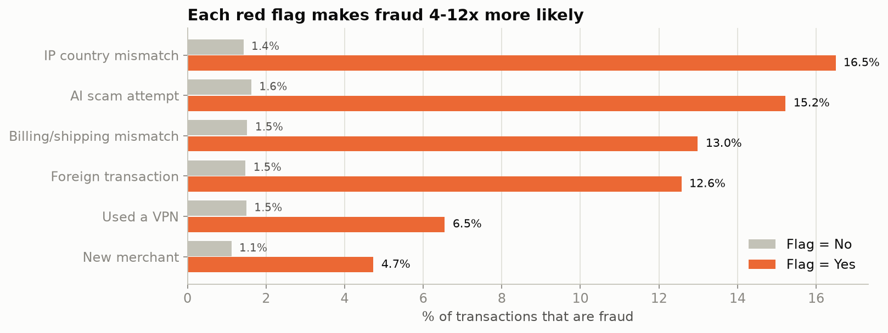
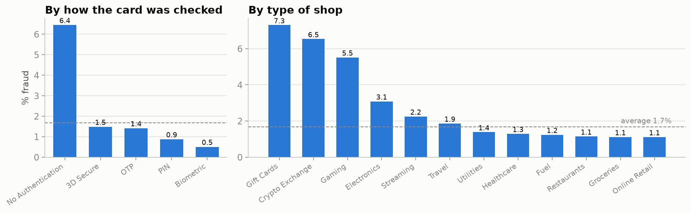
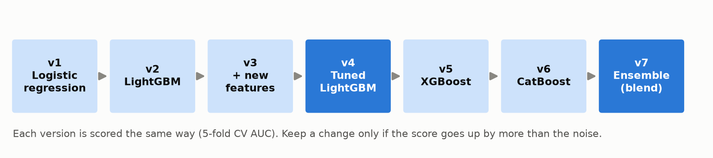
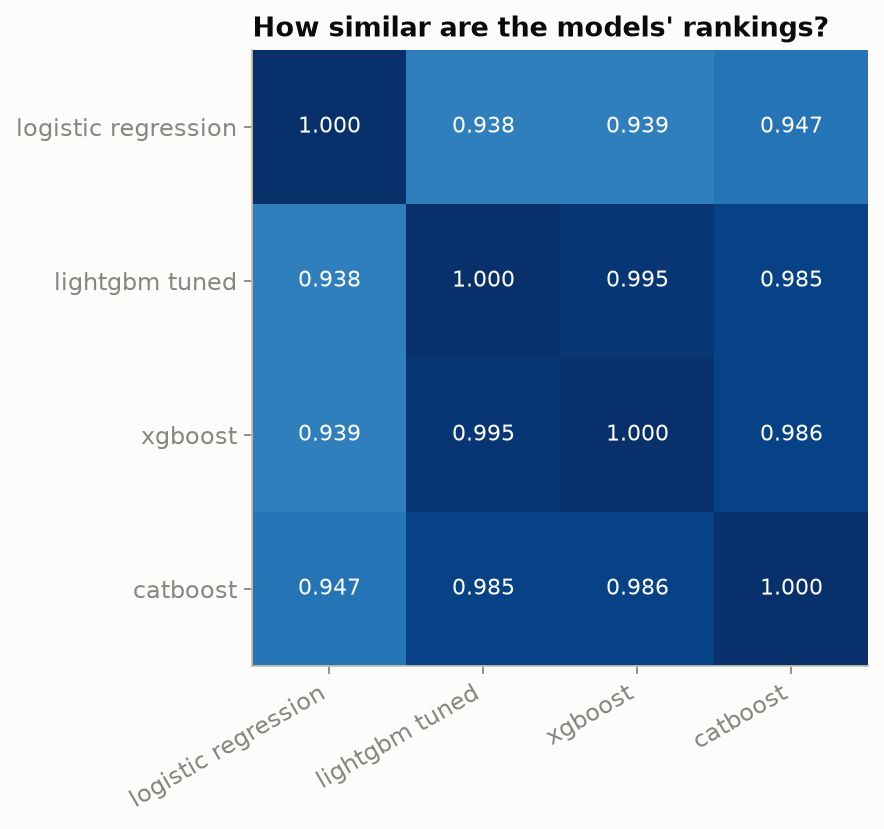
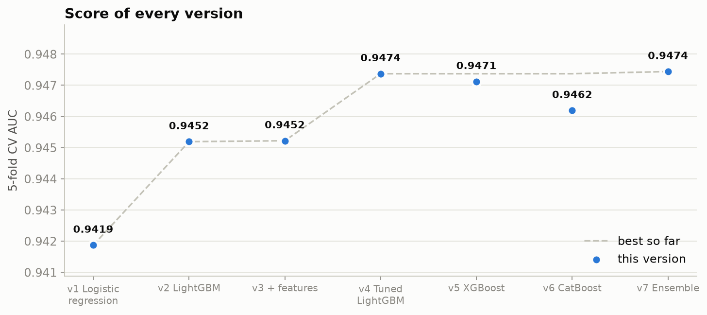

# Catching Credit Card Fraud: A Complete Beginner's Guide

*Kaggle Playground Series S6E11: "Predicting Credit Card Fraud", built up one model at a time*

---

## How to use this guide

This guide assumes you have done (or read) the Titanic project, or that you are brand new. It explains everything from scratch, but this time the focus is on **improving a model step by step**: we build seven versions, and for each one we explain **what changed, why it should help, and whether it actually did**.

Every important idea has two explanations:

> **Explain like I'm 5:** a simple story version you can picture.

...followed by the grown-up version. New words are in the **Glossary** at the end.

---

## Table of contents

1. What is this competition?
2. The big challenge: fraud is rare
3. How we are scored: AUC
4. Setting up
5. Looking at the data
6. How we test every version fairly (cross-validation)
7. **v1** Logistic regression (the baseline)
8. **v2** LightGBM (gradient-boosted trees)
9. **v3** Adding new features
10. **v4** Tuning LightGBM (slow and steady)
11. **v5** XGBoost
12. **v6** CatBoost
13. **v7** Ensemble (blending models)
14. The whole journey on one page
15. Submitting to Kaggle
16. Common mistakes and how to fix them
17. What to try next
18. Glossary

---

## 1. What is this competition?

Banks process millions of card payments every day. A tiny number of them are **fraud**: a criminal using a stolen card. The bank wants to spot those payments automatically so it can block them or text the customer.

Kaggle gives us:

- `train.csv`: **699,960 past transactions**, each labelled `is_fraud` = 1 (fraud) or 0 (normal).
- `test.csv`: **299,984 new transactions** with the label hidden.

For each test transaction we must give a **probability of fraud** between 0 and 1.

> **Explain like I'm 5:** You are a shop security guard. You've watched recordings of 700,000 shoppers and you know which ones were shoplifters. Now 300,000 new shoppers walk in. For each one, you say how suspicious they look, from 0 ("totally fine") to 1 ("definitely a thief").

This is a **Playground** competition: the data is *synthetic*, meaning a computer generated it to imitate a real fraud dataset. That keeps real customers' data private, and it also means some "real world" tricks behave a bit differently, as we'll see.

---

## 2. The big challenge: fraud is rare


Only **1.67%** of transactions are fraud, about 1 in 60. This is called an **imbalanced** problem.

> **Explain like I'm 5:** If you're looking for the one red marble in a jar of 60 marbles, and you just say "every marble is blue", you'll be right 59 times out of 60. You'd score 98%! But you never found the red marble, so you're useless.

That is why **accuracy is a bad score here**. A model that always says "not fraud" is 98.3% accurate and catches zero fraud. We need a score that rewards *finding* fraud. That's AUC.

---

## 3. How we are scored: AUC

The competition says: *"Submissions are evaluated on area under the ROC curve between the predicted probability and the observed target."* That's **AUC** (Area Under the ROC Curve).

### The simple idea: a line-up


Sort all transactions from most suspicious to least suspicious using your model's scores. A perfect model puts **every** fraud before **every** normal transaction.

**AUC = the chance that, if you pick one random fraud and one random normal transaction, the model gave the fraud the higher score.**

| AUC | Meaning |
|---|---|
| 1.0 | Perfect line-up: all frauds first |
| 0.95 | Very good: 95% of fraud/normal pairs ranked correctly |
| 0.5 | Useless: same as shuffling randomly |

> **Explain like I'm 5:** The teacher lines up all the kids from "most likely ate the cookie" to "least likely". AUC asks: if I pick one cookie-eater and one innocent kid, how often is the cookie-eater standing closer to the front?

**Two important consequences:**

1. Only the **order** matters, not the exact numbers. Predicting 0.9 vs 0.6 for a fraud doesn't matter as long as it's above the normal ones. We'll use this trick in v7.
2. That's why Kaggle wants **probabilities**, not 0/1 answers. With only 0/1 you can't make a fine-grained line-up.

### The ROC curve

The "curve" in the name plots, for every possible cut-off, how much fraud you catch vs. how many false alarms you raise. AUC is the area under it. Bigger area = better.


---

## 4. Setting up

**Option A: Kaggle Notebook** (no install): open the competition, click **Code → New Notebook**. Data is at `/kaggle/input/playground-series-s6e11/`.

**Option B: your own computer:**

```bash
python -m pip install pandas scikit-learn lightgbm xgboost catboost matplotlib
```

Download the data from the competition's **Data** tab (you must click **Join Competition** first) and unzip into:

```
Predicting Credit Card Fraud/
├── data/            train.csv, test.csv, sample_submission.csv
├── common.py        shared code: loading, features, cross-validation
├── v1_logistic_regression.py
├── v2_lightgbm.py
├── ... v7_ensemble.py
├── oof/             saved predictions (created when you run the scripts)
├── submissions/     files to upload to Kaggle
└── results.csv      the CV score of every version
```

Run each version with `python v1_logistic_regression.py`, etc. (from inside the folder).

---

## 5. Looking at the data

Each row is one card payment with 24 clues:

| Type | Columns |
|---|---|
| **Numbers** (13) | `amount_usd`, `hours_since_last_txn`, `txn_count_last_24h`, `distance_from_home_km`, `card_age_months`, `customer_age`, `account_balance_usd`, `cvv_retry_count`, `velocity_score`, `time_of_day_hour`, `day_of_week`, `merchant_risk_score`, `prior_disputes` |
| **Categories** (5) | `merchant_category` (Groceries, Gift Cards...), `card_type`, `auth_method` (PIN, OTP, No Authentication...), `channel`, `device_type` |
| **Yes/No flags** (6) | `is_foreign_transaction`, `is_new_merchant`, `used_vpn`, `ip_country_mismatch`, `billing_shipping_mismatch`, `is_ai_generated_scam_attempt` |

Good news: **no missing values**, so no gap-filling needed.

### The red flags



Every yes/no flag is a strong warning sign. When the card is used from an IP address in a different country than the cardholder, fraud jumps from 1.4% to **16.5%**, nearly 12 times higher.

### Categories



- **No Authentication** (no PIN, no code) → 6.4% fraud. **Biometric** (fingerprint/face) → only 0.5%.
- **Gift cards, crypto exchanges and gaming** are fraudsters' favourites (5.5% to 7.3%), because they're easy to turn into cash.

### Numbers


We can compute an AUC for each number alone. `merchant_risk_score`, `velocity_score` (how fast the card is being used) and `cvv_retry_count` (how many times the 3-digit code was typed wrong) are the strongest. `time_of_day_hour` is basically useless on its own (0.500).

> **Explain like I'm 5:** A detective lists clues. "The thief typed the secret code wrong 3 times" is a great clue. "It happened on a Tuesday" isn't a clue at all.

---

## 6. How we test every version fairly (cross-validation)

We'll build 7 versions. To know whether a new version is *really* better, every version is tested in **exactly the same way**:

1. Split the 699,960 training rows into **5 folds** (groups), keeping the same 1.67% fraud rate in each (*stratified*).
2. Train on 4 folds, predict the 5th. Repeat 5 times so every row gets a prediction from a model that never saw it. These are **out-of-fold (OOF)** predictions.
3. Compute the AUC of all OOF predictions = the **CV AUC**.
4. For the test set, average the 5 fold-models' predictions.

> **Explain like I'm 5:** Five practice exams. Each time you study four chapters and get quizzed on the fifth. Your real grade is your average across all five quizzes. And every version of you takes the *same five quizzes*, so the comparison is fair.

All of this lives in one function in `common.py`, `run_cv()`, so every version uses identical folds (`random_state=42`):

```python
from sklearn.model_selection import StratifiedKFold
from sklearn.metrics import roc_auc_score

skf = StratifiedKFold(n_splits=5, shuffle=True, random_state=42)
oof = np.zeros(len(X))
for train_idx, valid_idx in skf.split(X, y):
    p_valid, p_test = fit_predict(X.iloc[train_idx], y[train_idx], X.iloc[valid_idx], y[valid_idx], X_test)
    oof[valid_idx] = p_valid
print("CV AUC:", roc_auc_score(y, oof))
```

**How do we know an improvement is real?** Two checks:

- Is the gain bigger than the **noise**? Fold AUCs vary by about ±0.003.
- Does the new version win **in every fold**? Because all versions use the same folds, a version that wins 5 out of 5 is genuinely better, even if the gain is small.



---

## 7. v1: Logistic regression (the baseline)

**File:** `v1_logistic_regression.py` | **CV AUC: 0.94187**

Always start with something simple. It tells you what "good" looks like and catches bugs early.

**Logistic regression** gives each clue a weight (points), adds them up, and squashes the total into a probability between 0 and 1.

> **Explain like I'm 5:** A scorecard. "Foreign transaction: +2 points. Fingerprint used: -3 points. Gift card shop: +1 point." Add up the points. Lots of points = suspicious.

It needs two preparation steps:

- **One-hot encoding** turns each category into 0/1 columns ("Gift Cards" → `merchant_category_Gift Cards = 1`).
- **Standard scaling** puts every number on a similar scale. Otherwise `account_balance_usd` (up to 99,701) would drown out `cvv_retry_count` (0 to 3).

```python
from sklearn.compose import ColumnTransformer
from sklearn.linear_model import LogisticRegression
from sklearn.pipeline import make_pipeline
from sklearn.preprocessing import OneHotEncoder, StandardScaler

pre = ColumnTransformer([("num", StandardScaler(), NUMS + FLAGS),
                         ("cat", OneHotEncoder(handle_unknown="ignore"), CATS)])
model = make_pipeline(pre, LogisticRegression(max_iter=2000))
```

**Result: 0.94187.** Already very good! The red flags are so strong that a simple points system works well. Its limitation: it can only *add* clues. It can't learn "this flag matters a lot *only when* the amount is large".

---

## 8. v2: LightGBM (gradient-boosted trees)

**File:** `v2_lightgbm.py` | **CV AUC: 0.94519** | **vs v1: +0.0034, better in 5/5 folds ✅**

### What changed

We switched from a scorecard to **gradient-boosted decision trees**, using the LightGBM library.

A **decision tree** asks yes/no questions ("Is there an IP mismatch?" → "Is the amount over $200?" → ...) until it reaches an answer. **Boosting** builds many small trees *one after another*, where each new tree focuses on the mistakes the previous trees made. The final score is the sum of all the trees.


> **Explain like I'm 5:** The first student answers the quiz and gets some wrong. The second student only studies the questions the first one got wrong. The third studies what's *still* wrong. Put all their answers together and the team gets almost everything right.

### Why it should be better

Trees can learn **combinations** ("no authentication AND gift card AND foreign = very suspicious") and **thresholds** ("velocity above 40 is dangerous, below is fine"). The scorecard can't.

Bonus: trees don't need scaling or one-hot encoding. LightGBM reads text categories directly if we mark them as `category` type.

```python
import lightgbm as lgb

model = lgb.LGBMClassifier(objective="binary", learning_rate=0.05, n_estimators=5000, num_leaves=31)
model.fit(X_tr, y_tr, eval_set=[(X_va, y_va)], eval_metric="auc",
          callbacks=[lgb.early_stopping(200)])
```

**Early stopping:** we allow up to 5,000 trees but stop when the AUC on the validation fold hasn't improved for 200 trees. Here it stopped at only about 200 to 400 trees. Remember this: it's a clue for v4.

### Did it work?

**Yes: 0.94187 → 0.94519**, and it won in all 5 folds. Learning combinations of clues helps.

---

## 9. v3: Adding new features

**File:** `v3_lightgbm_features.py` | **CV AUC: 0.94522** | **vs v2: +0.0001, better in 3/5 folds ❌ (no real gain)**

### What changed

Same model as v2, plus 13 hand-made clues (**feature engineering**), in `common.engineered_features()`:

| New clue | Idea |
|---|---|
| `flag_count` | How many red flags at once |
| `amount_to_balance` | Spending a big share of the balance? |
| `amount_vs_category` | Unusually big for this type of shop? |
| `is_night` | Between midnight and 6 am |
| `risk_x_velocity` | Risky shop AND card used rapidly |
| `no_auth`, `weak_auth_risky` | No authentication, combined with flags |
| `txn_per_hour` | Burst of transactions |
| `*_freq` (4 columns) | How common is this exact value? (a known trick for synthetic data) |

> **Explain like I'm 5:** Instead of giving the detective raw facts, we hand them ready-made hints: "this person had 3 red flags at once".

### Did it work?

**No.** 0.94519 → 0.94522 is a change of 0.00003, far smaller than the noise, and it won only 3 of 5 folds (a coin flip).

### Why not?

- **Trees already find these combinations themselves.** `flag_count` is just "flag A and flag B and...", which trees learn naturally.
- In this synthetic data, the signal is mostly in the individual columns, not in ratios between them.

**Lesson:** a feature that *sounds* smart isn't automatically useful. **Always measure.** Because v3 added complexity without gain, **we dropped these features** and went back to the raw 24 columns for v4 onwards. Throwing away work that didn't help is a normal and important part of data science.

---

## 10. v4: Tuning LightGBM (slow and steady)

**File:** `v4_lightgbm_tuned.py` | **CV AUC: 0.94737** | **vs v2: +0.0022, better in 5/5 folds ✅**

### The clue from v2

v2 stopped after only ~300 trees. That means after 300 trees, the model started **memorising** the training data (**overfitting**) and got *worse* on unseen data. The picture below shows it clearly:


The orange line (v2) shoots up fast, peaks at about 300 trees, then **falls**. The blue line (v4) climbs slowly but keeps going higher.

> **Explain like I'm 5:** One student crams the night before: learns fast, but mixes things up and forgets. Another studies a little every day: slower, but understands it better and scores higher in the end.

### What changed (the settings, called *hyperparameters*)

| Setting | v2 | v4 | Why |
|---|---|---|---|
| `learning_rate` | 0.05 | **0.02** | Each tree makes a smaller correction, so the model learns more carefully |
| `max_depth` | unlimited | **4** | Smaller trees can only learn simpler rules, so less memorising |
| `min_child_samples` | 20 | **300** | A rule must apply to at least 300 transactions, so no rules for weird one-offs |
| `colsample_bytree` | 1.0 | **0.4** | Each tree sees a random 40% of the clues, so it can't over-rely on one |
| `subsample` | 1.0 | **0.7** | Each tree sees a random 70% of the rows |
| `reg_lambda` | 0 | **10** | Penalises extreme predictions |
| `cat_smooth` | 10 | **50** | Smoother handling of rare categories |

These all push in the same direction: **regularisation**, meaning "don't trust any single pattern too much".

We picked these by trying three settings in `tune_lightgbm.py` (results in `tune_lightgbm_results.txt`). All three scored about 0.9473, with the depth-limited one slightly ahead.

```python
PARAMS = dict(objective="binary", n_estimators=10000, learning_rate=0.02, max_depth=4,
              min_child_samples=300, colsample_bytree=0.4, subsample=0.7, subsample_freq=1,
              reg_lambda=10, cat_smooth=50)
```

### Did it work?

**Yes: 0.94519 → 0.94737** (+0.0022), winning **all 5 folds**. This was the second-biggest jump of the project. It now uses ~2,000 trees instead of ~300, and each one is small and careful.

---

## 11. v5: XGBoost

**File:** `v5_xgboost.py` | **CV AUC: 0.94712** | **vs v4: -0.0002, better in 0/5 folds ❌ (but useful later)**

### What changed

**XGBoost** is another gradient-boosting library, the one that made boosting famous. Same idea as LightGBM, but it grows trees differently (level by level instead of leaf by leaf) and handles categories differently. We gave it the same "slow and steady" settings.

> **Explain like I'm 5:** Another student who learned from a different teacher. They know the same subject but think about some questions a bit differently.

### Did it work?

On its own, **slightly worse** (0.94712 vs 0.94737, lost all 5 folds by a hair). So why keep it? Because **a different model makes slightly different mistakes**, and that's exactly what an ensemble needs (v7).

---

## 12. v6: CatBoost

**File:** `v6_catboost.py` | **CV AUC: 0.94619** | **vs v4: -0.0012, better in 0/5 folds ❌ (but useful later)**

### What changed

**CatBoost** ("Categorical Boosting") is a third boosting library. It was designed specifically for category columns: it replaces each category with a carefully computed fraud rate, in a way that avoids peeking at the answers. It also builds **symmetric** trees (every branch at the same level asks the same question), which makes them very stable.

### Did it work?

Weaker on its own (0.94619), and much slower (29 minutes vs 3 for LightGBM). Here our categories only have 5 to 12 values each, so CatBoost's special category handling has little to offer. But again it's the most *different* of the three boosters, which makes it valuable for blending.

---

## 13. v7: Ensemble (blending models)

**File:** `v7_ensemble.py` | **CV AUC: 0.94744** | **vs v4: +0.0001, better in 5/5 folds ✅ (small but consistent)**

### What changed

We combine the predictions of v4, v5, v6 and v1 into one.

> **Explain like I'm 5:** Ask four doctors instead of one. Each one is sometimes wrong, but rarely all in the same way. If you combine their opinions, you make fewer mistakes.

### Step 1: turn probabilities into ranks

Different models output probabilities on different scales. CatBoost might say 0.30 where LightGBM says 0.91 for the same transaction. Averaging raw numbers would let the "louder" model dominate. Since AUC only cares about **order**, we convert each model's predictions into **ranks** between 0 and 1 first, then average:


### Step 2: find the best weights

Instead of a plain average, we let the computer search for the weights that give the highest AUC on the out-of-fold predictions (`scipy.optimize.minimize`). It chose:

| Model | Weight |
|---|---|
| v4 LightGBM | 0.63 |
| v5 XGBoost | 0.24 |
| v6 CatBoost | 0.12 |
| v1 Logistic regression | 0.01 |

A plain equal-weight average scored only 0.94702, *worse* than v4 alone, because the weak logistic model got 25% of the vote. Weights matter.

### Why the gain is small



The three boosting models rank transactions **98.5% to 99.5% the same**. Blending only helps where models disagree, and these barely disagree. They all learned the same patterns from the same clues.

### Did it work?

**Yes, a little: 0.94737 → 0.94744**, and it won **all 5 folds**, so the gain is real, just small. This is our best model.

---

## 14. The whole journey on one page



| Version | What changed | CV AUC | vs best before | Kept? |
|---|---|---|---|---|
| v1 | Logistic regression (scorecard) | 0.94187 | baseline | baseline |
| v2 | Gradient-boosted trees (LightGBM) | 0.94519 | **+0.0033** (5/5 folds) | ✅ |
| v3 | + 13 hand-made features | 0.94522 | +0.0000 (3/5 folds) | ❌ dropped |
| v4 | Regularised: small trees, slow learning | 0.94737 | **+0.0022** (5/5 folds) | ✅ |
| v5 | XGBoost | 0.94712 | -0.0002 | for blending |
| v6 | CatBoost | 0.94619 | -0.0012 | for blending |
| v7 | Weighted rank-blend of v4, v5, v6, v1 | **0.94744** | **+0.0001** (5/5 folds) | ✅ best |

### What does 0.947 mean in practice?

If the bank checks the **top 5%** most suspicious transactions flagged by v7, it catches **71.5%** of all fraud. Checking just the **top 1%** catches 38.9%. (v1 caught 69.9% and 37.7%.)

### The three big lessons

1. **Start simple.** The baseline was already 0.942. Everything after that added only 0.005.
2. **Measure everything.** Smart-sounding features (v3) did nothing. A boring settings change (v4) was the biggest win after switching models.
3. **Small, consistent gains are real.** When every version uses the same folds, winning 5 out of 5 folds proves a gain even if it's tiny.

---

## 15. Submitting to Kaggle

Every script writes a file to `submissions/` in exactly the format Kaggle wants (299,984 rows):

```
id,is_fraud
699960,0.0123
699961,0.0087
...
```

**Upload order:** `v7_ensemble.csv` first (best CV), then `v4_lightgbm_tuned.csv` to compare.

Go to the competition page → **Submit Prediction** → upload the file → add a short description:

- v7: *"Weighted rank blend LGBM+XGB+CatBoost (CV AUC 0.94744)"*
- v4: *"Regularised LightGBM, raw features (CV AUC 0.94737)"*

**Public vs private leaderboard:** in Playground competitions the public leaderboard uses only about 20% of the test set. The final ranking uses the other 80%. Trust your CV score more than small public-leaderboard differences.

---

## 16. Common mistakes and how to fix them

| Problem | Cause | Fix |
|---|---|---|
| Score looks great with **accuracy** | Imbalanced data: "never fraud" gets 98% | Use AUC (the competition metric) |
| Submitting 0/1 labels | `model.predict()` instead of probabilities | Use `model.predict_proba(X)[:, 1]` |
| `could not convert string to float` | Text columns given to a model that needs numbers | Mark as `category` for LightGBM/XGBoost, or one-hot encode for logistic regression |
| Different scores every run | No fixed random seed | Set `random_state=42` everywhere, including the folds |
| CV says better, leaderboard says worse | Normal noise on a small public sample | Trust CV. Only trust gains that win in every fold |
| Training takes forever | CatBoost on 700k rows, or tiny learning rate | Start with LightGBM; use early stopping |
| Comparing versions on different folds | Unfair comparison | Use one shared CV function with a fixed seed (`common.run_cv`) |

---

## 17. What to try next

- **Add the original dataset.** Playground data is generated from a real dataset (here, `credit_card_fraud_2026.csv`). Appending it to the training data often helps a little.
- **Automatic tuning** with Optuna: let the computer try hundreds of settings.
- **Seed averaging:** train v4 with 5 different random seeds and average. It's cheap and usually helps a bit.
- **Stacking:** instead of fixed weights, train a small logistic regression on the models' OOF predictions.
- **Neural networks** (e.g. an MLP) are more *different* from trees than XGBoost is, so they can add more to an ensemble.

---

## 18. Glossary

| Term | Meaning |
|---|---|
| **AUC** | Area under the ROC curve: the chance a random fraud is ranked above a random normal transaction |
| **Baseline** | The first, simple model that everything else is compared against |
| **Boosting** | Building many small models one after another, each fixing the previous ones' mistakes |
| **CatBoost / LightGBM / XGBoost** | Three popular gradient-boosting libraries |
| **Category / categorical** | A column of labels (e.g. "Gift Cards") rather than numbers |
| **Cross-validation (CV)** | Testing by rotating which part of the data is held out |
| **Early stopping** | Stop adding trees when the validation score stops improving |
| **Ensemble / blend** | Combining several models' predictions |
| **Feature engineering** | Making new clues out of existing columns |
| **Fold** | One of the K groups the data is split into for CV |
| **Hyperparameter** | A setting you choose before training (learning rate, tree depth...) |
| **Imbalanced data** | One class (fraud) is much rarer than the other |
| **Learning rate** | How big a correction each new tree is allowed to make |
| **Logistic regression** | A model that adds weighted clues and turns the sum into a probability |
| **One-hot encoding** | Turning a category into several 0/1 columns |
| **OOF (out-of-fold) prediction** | A prediction made by a model that never saw that row in training |
| **Overfitting** | Memorising the training data instead of learning patterns that generalise |
| **Probability** | A number from 0 (surely normal) to 1 (surely fraud) |
| **Rank** | A position in a sorted list, scaled here to 0..1 |
| **Regularisation** | Settings that stop a model from trusting any pattern too much |
| **ROC curve** | Plot of frauds caught vs. false alarms at every cut-off |
| **Stratified** | Splitting so each fold has the same fraud rate as the whole data |
| **Synthetic data** | Data generated by a computer to imitate a real dataset |

---

*Data: Kaggle Playground Series S6E11, "Predicting Credit Card Fraud". All numbers in this guide come from running the code in this folder (`results.csv`).*
