# Predicting Titanic Survivors: A Complete Beginner's Guide

*Your first machine learning project, from zero to a Kaggle submission*

---

## How to use this guide

This guide assumes you know **nothing** about machine learning and very little about programming. By the end you will have:

1. Built a model that predicts who survived the Titanic.
2. Submitted it to Kaggle and got a real score.
3. Improved it step by step, and understood *why* each step helps.

Every important idea has two explanations:

> **Explain like I'm 5:** a simple story version you can picture.

...followed by the grown-up version. Read the story first, then the details. If a word is unfamiliar, check the **Glossary** at the end.

---

## Table of contents

1. What is this project?
2. What is machine learning?
3. Setting up (two options)
4. Step 1: Get the data
5. Step 2: Look at the data
6. Step 3: Clean the data
7. Step 4: Turn words into numbers
8. Step 5: Train your first model (the tutorial model)
9. Step 6: Submit to Kaggle
10. Step 7: How do we know if a model is good? (Cross-validation)
11. Step 8: Making better clues (feature engineering)
12. Step 9: The family trick
13. Step 10: Trying different models
14. Results: what actually helped
15. Common mistakes and how to fix them
16. What to do next
17. Glossary

---

## 1. What is this project?

In 1912 the ship *Titanic* hit an iceberg and sank. There were not enough lifeboats, and about 1,500 of the 2,224 people on board died. Survival was not pure luck: some groups of people (like women, children and first-class passengers) were much more likely to survive.

**Kaggle** is a website that runs data science competitions. Its "Titanic" competition is the classic first project. It gives you:

- A list of **891 passengers** where you are told whether each one survived.
- A list of **418 other passengers** where the answer is hidden.

Your job: write a program that **guesses** whether each of the 418 hidden passengers survived. Kaggle then tells you what percentage you got right.

> **Explain like I'm 5:** Imagine a teacher shows you 891 picture cards of people. On the back of each card it says "saved" or "not saved". You study the cards and notice patterns, like "most of the ladies were saved". Then the teacher gives you 418 new cards with the back covered up, and you have to guess. The more patterns you spot, the more you get right.

---

## 2. What is machine learning?

Normal programming: **you** write the rules.

```
if passenger is female: guess "survived"
```

Machine learning: you give the computer **examples with answers**, and the computer **finds the rules by itself**.

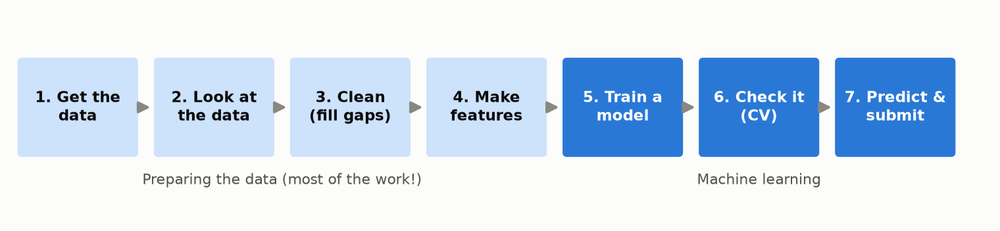

> **Explain like I'm 5:** Teaching a computer is like teaching a puppy. You don't explain the rules in words. You show it lots of examples ("good dog!", "no!") until it figures out the pattern on its own.

Some words you will see everywhere:

| Word | Meaning | Titanic example |
|---|---|---|
| **Feature** | A clue we give the computer | Sex, age, ticket class |
| **Target** (or label) | The answer we want to predict | Survived (1 = yes, 0 = no) |
| **Model** | The "brain" that learns the rules | A random forest |
| **Training** | Letting the model study examples | Showing it the 891 passengers |
| **Prediction** | The model's guess | "Passenger 892: did not survive" |
| **Accuracy** | % of guesses that were right | 0.775 = 77.5% correct |

---

## 3. Setting up (two options)

### Option A: Kaggle Notebook (easiest, nothing to install)

1. Create a free account at **kaggle.com**.
2. Open the competition page: **kaggle.com/competitions/titanic** and click **Join Competition** (accept the rules).
3. Click **Code** then **New Notebook**. The Titanic data is already attached at `/kaggle/input/titanic/`.
4. Type the code from this guide into the notebook cells and press **Shift + Enter** to run each cell.

### Option B: On your own computer

1. Install **Python** from python.org (tick "Add Python to PATH" during install).
2. Install **VS Code** from code.visualstudio.com (a program for writing code).
3. Open a terminal and install the libraries we need:

```bash
python -m pip install pandas scikit-learn matplotlib
```

4. Download `train.csv` and `test.csv` from the competition's **Data** tab and put them in a folder like this:

```
Titanic/
├── data/
│   ├── train.csv
│   └── test.csv
└── titanic_model.py      <- your code goes here
```

> **Explain like I'm 5:** Python is the language we speak to the computer. **pandas** is a helper that is really good at reading tables (like a super spreadsheet). **scikit-learn** is a toolbox full of ready-made "brains" (models) so we don't have to build them ourselves.

---

## 4. Step 1: Get the data

```python
import pandas as pd

train_data = pd.read_csv("data/train.csv")   # on Kaggle: "/kaggle/input/titanic/train.csv"
test_data  = pd.read_csv("data/test.csv")    # on Kaggle: "/kaggle/input/titanic/test.csv"

print(train_data.shape)   # (891, 12) -> 891 rows, 12 columns
print(test_data.shape)    # (418, 11) -> no "Survived" column!
train_data.head()         # show the first 5 rows
```

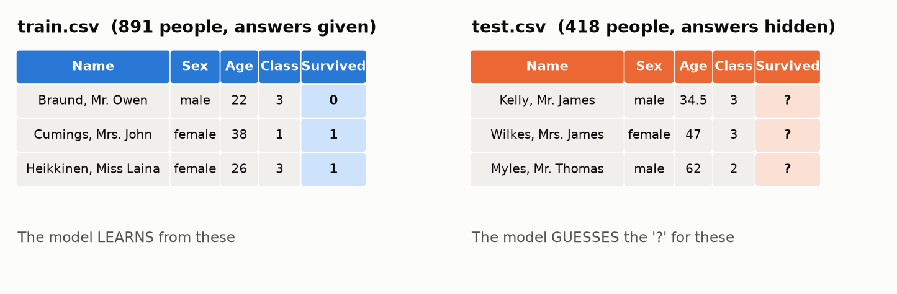

**What each column means:**

| Column | Meaning |
|---|---|
| `PassengerId` | A number for each person |
| `Survived` | **The answer**: 1 = survived, 0 = died (only in train) |
| `Pclass` | Ticket class: 1 = first (rich), 2 = second, 3 = third (cheapest) |
| `Name` | Full name, including a title like Mr, Mrs, Miss, Master |
| `Sex` | male / female |
| `Age` | Age in years (sometimes blank) |
| `SibSp` | Number of **sib**lings or **sp**ouses on board |
| `Parch` | Number of **par**ents or **ch**ildren on board |
| `Ticket` | Ticket number (families often shared one) |
| `Fare` | How much the ticket cost |
| `Cabin` | Cabin number (mostly blank) |
| `Embarked` | Port where they got on: S = Southampton, C = Cherbourg, Q = Queenstown |

---

## 5. Step 2: Look at the data

Before building anything, a good data scientist **looks** at the data. This is called *exploratory data analysis*.

```python
# What fraction of women survived?
women = train_data.loc[train_data.Sex == "female"]["Survived"]
print("% of women who survived:", sum(women) / len(women))   # 0.742

men = train_data.loc[train_data.Sex == "male"]["Survived"]
print("% of men who survived:", sum(men) / len(men))         # 0.189

# Survival rate by class
print(train_data.groupby("Pclass")["Survived"].mean())
```

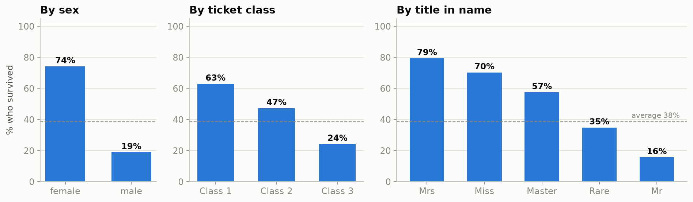

Three big lessons jump out:

- **Women survived far more** than men (74% vs 19%). The rule at the time was "women and children first".
- **Richer passengers survived more.** First-class cabins were closer to the lifeboats.
- **The title in the name** (Mr, Mrs, Miss, Master) splits people even better than sex alone. "Master" was the title for **young boys**, and they survived far more often (57%) than adult men (16%).

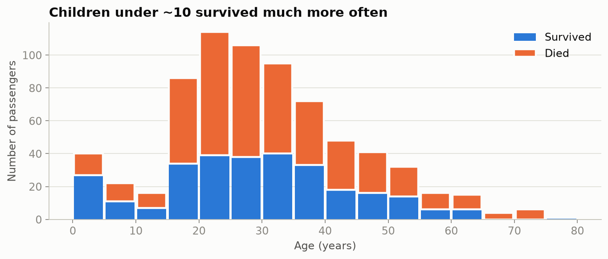

> **Explain like I'm 5:** Before you play a guessing game, peek at the cards you're allowed to see. You quickly notice "wow, lots of ladies and little kids got saved, but not many grown-up men". That noticing is the most important part of the whole project.

---

## 6. Step 3: Clean the data (fill the gaps)

Some boxes in the table are empty:

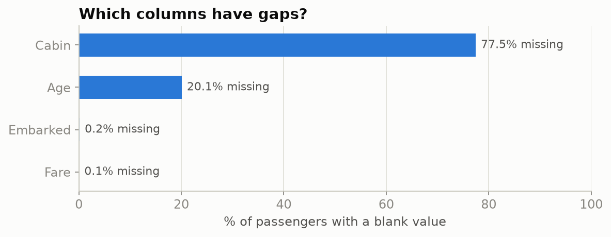

Models cannot handle blank boxes, so we must fill them in sensibly:

| Column | Problem | Our fix | Why |
|---|---|---|---|
| `Age` | 20% blank | Fill with the **median age for that person's title** | A "Master" is a little boy (~4 yrs), a "Mr" is an adult (~29 yrs). Much better than one average for everyone. |
| `Fare` | 1 blank | Median fare for their class | First-class tickets cost more |
| `Embarked` | 2 blank | `"S"` (the most common port) | Most people boarded there |
| `Cabin` | 77% blank | Don't fill. Just make a yes/no column `HasCabin` | Too many gaps to guess |

```python
# Pull the title out of the name: "Braund, Mr. Owen Harris" -> "Mr"
for df in [train_data, test_data]:
    df["Title"] = df["Name"].str.extract(r",\s*([^\.]+)\.", expand=False).str.strip()
    df["Title"] = df["Title"].replace({"Mlle": "Miss", "Ms": "Miss", "Mme": "Mrs"})
    df.loc[~df["Title"].isin(["Mr", "Mrs", "Miss", "Master"]), "Title"] = "Rare"

# Fill missing ages using the median age of each title
all_data = pd.concat([train_data, test_data])
age_by_title = all_data.groupby("Title")["Age"].median()
for df in [train_data, test_data]:
    df["Age"] = df["Age"].fillna(df["Title"].map(age_by_title))
    df["Fare"] = df["Fare"].fillna(all_data["Fare"].median())
    df["Embarked"] = df["Embarked"].fillna("S")
```

> **Explain like I'm 5:** Some cards have a smudge where the age should be. Instead of throwing the card away, we make a smart guess: if the card says "Master" (a little boy), we write "about 4". If it says "Mr", we write "about 29".

The weird-looking `r",\s*([^\.]+)\."` is a **regular expression**, a mini-language for finding text patterns. It means: "after the comma and space, grab everything up to the next full stop". You don't need to master these now. Copy it and move on.

---

## 7. Step 4: Turn words into numbers

Models only understand numbers. "male" and "female" are words, so we convert them. The standard trick is **one-hot encoding**, done in pandas with `get_dummies`:

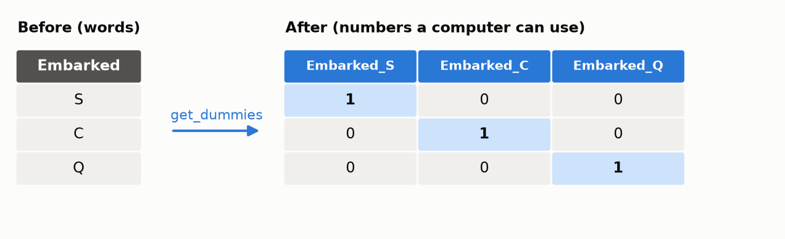

```python
features = ["Pclass", "Sex", "SibSp", "Parch"]
X = pd.get_dummies(train_data[features])       # Sex becomes Sex_female and Sex_male
X_test = pd.get_dummies(test_data[features])
y = train_data["Survived"]                     # the answers
```

> **Explain like I'm 5:** A computer can't read the word "Southampton". So we give each port its own light switch. If you got on at Southampton, that switch is ON (1) and the others are OFF (0).

**Why not just number them S=1, C=2, Q=3?** Because then the computer would think Queenstown is "bigger" than Southampton, which makes no sense. Separate switches avoid that.

By convention, **`X`** means "the clues" and **`y`** means "the answers".

---

## 8. Step 5: Train your first model (the tutorial model)

We'll use a **Random Forest**. To understand it, first understand a **decision tree**.

### Decision tree: a game of 20 questions

A decision tree asks yes/no questions, one after another, until it reaches an answer. Here is a real tree built from the training data:

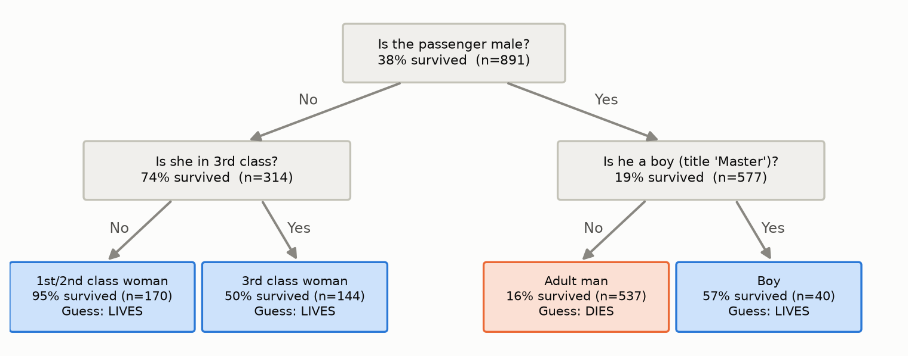

> **Explain like I'm 5:** It's like the game "Guess Who?". "Is it a man?" Yes. "Is he a little boy?" No. "Then I guess... he didn't make it." The computer picks the questions that split the people into the most "same-answer" groups.

### Random forest: ask lots of trees and vote

One tree can make silly mistakes. So a **random forest** grows many trees (we use 100). Each one is trained on a slightly different random sample of passengers and clues, so each makes *different* mistakes. Then they **vote**.

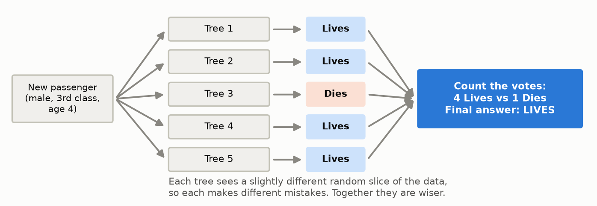

> **Explain like I'm 5:** If you ask one friend a hard question, they might be wrong. If you ask 100 friends and go with what most of them say, you're much more likely to be right.

### The code

```python
from sklearn.ensemble import RandomForestClassifier

model = RandomForestClassifier(n_estimators=100, max_depth=5, random_state=1)
model.fit(X, y)                    # learn from the 891 examples
predictions = model.predict(X_test)  # guess the 418 hidden ones
```

What the settings mean:

| Setting | Meaning |
|---|---|
| `n_estimators=100` | Grow 100 trees |
| `max_depth=5` | Each tree may ask at most 5 questions in a row. This stops trees from memorising every single passenger. |
| `random_state=1` | Makes the "randomness" repeatable, so you get the same result every run |

---

## 9. Step 6: Submit to Kaggle

Kaggle wants a file with exactly two columns: `PassengerId` and `Survived`, with 418 rows.

```python
output = pd.DataFrame({"PassengerId": test_data.PassengerId, "Survived": predictions})
output.to_csv("submission.csv", index=False)
print("Your submission was successfully saved!")
```

The file looks like this:

```
PassengerId,Survived
892,0
893,1
894,0
...
```

**To submit:**

- **Kaggle Notebook:** click **Save Version**, then **Save & Run All**. When it finishes, open the version, go to **Output**, and click **Submit**.
- **Own computer:** on the competition page click **Submit Predictions**, upload `submission.csv`, add a short description, click **Submit**.

**Our result: 0.77511** (77.5% correct). This exactly matches the official tutorial. Congratulations, you are on the leaderboard!

> **A note on 100% scores:** you will see people at the top with a perfect 1.00000. The true answers for the test passengers are public on the internet, so those scores almost always come from copying them, not from a model. Honest models score around 0.77 to 0.81. Don't compare yourself to them.

---

## 10. Step 7: How do we know if a model is good? (Cross-validation)

Kaggle only lets you submit 10 times a day, and you should not tune your model to the leaderboard. We need our own way to test models. The obvious idea is to check accuracy on the training data, but that is **cheating**:

> **Explain like I'm 5:** If you study a test and then take *the exact same test*, you'll get a great score, even if you just memorised it. To know if you really learned, the teacher must quiz you on questions you haven't seen.

The tutorial model scores 81.6% on its own training data but 77.5% on Kaggle. That gap is the "memorising" effect.

### The fix: cross-validation (CV)

Split the 891 passengers into 5 equal piles. Train on 4 piles, quiz on the 5th. Repeat 5 times so every pile gets a turn as the quiz. Average the 5 scores.

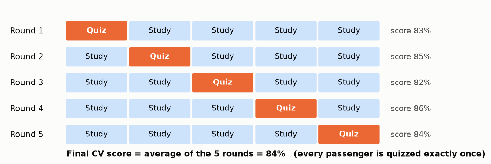

```python
from sklearn.model_selection import cross_val_score

scores = cross_val_score(model, X, y, cv=5)
print(f"CV accuracy: {scores.mean():.3f} +/- {scores.std():.3f}")
```

The `+/-` number tells you how **noisy** the score is. If two models differ by less than this, the difference is probably luck.

### Overfitting and underfitting

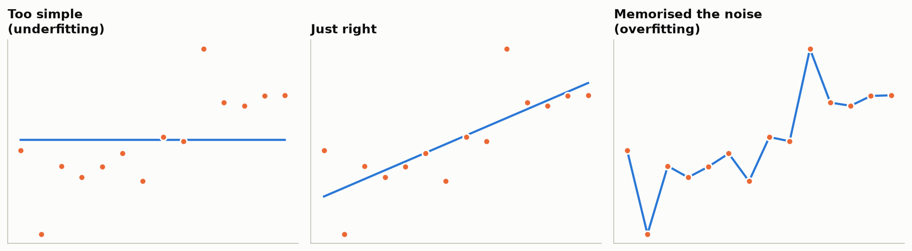

- **Underfitting:** the model is too simple to see the pattern (e.g. "everyone dies").
- **Overfitting:** the model memorised the noise in the training data and fails on new people.
- **Just right:** it learned the real pattern.

`max_depth=5` is one way we stop the forest from overfitting.

---

## 11. Step 8: Making better clues (feature engineering)

The tutorial only used 4 clues. Creating new, smarter clues from the raw columns is called **feature engineering**, and it is usually the biggest source of improvement.

> **Explain like I'm 5:** A detective doesn't just look at the footprint. They figure out "this footprint is small, so the person is probably a child". Turning raw facts into smart clues is what makes a great detective.

| New clue | How to make it | Why it helps |
|---|---|---|
| **Title** | From the name (see Step 3) | Separates boys (Master) from men (Mr), and married women from girls |
| **Age** | Filled using title | Children were saved first |
| **Fare** | Use `log(1 + Fare)` | Wealth. The log squashes the few huge fares so they don't dominate |
| **FamilySize** | `SibSp + Parch + 1` | People alone or in very big families did worse |
| **IsAlone** | `FamilySize == 1` | Solo travellers (mostly men) did worse |
| **IsChild** | `Age < 14` | Children first |
| **Embarked, Deck, HasCabin** | One-hot encode | Location on the ship, wealth |
| **TicketCount** | How many people share the ticket | Groups travelling together |

```python
import numpy as np

for df in [train_data, test_data]:
    df["FamilySize"] = df["SibSp"] + df["Parch"] + 1
    df["IsAlone"]    = (df["FamilySize"] == 1).astype(int)
    df["IsChild"]    = (df["Age"] < 14).astype(int)
    df["LogFare"]    = np.log1p(df["Fare"])

features = ["Pclass", "Sex", "Age", "LogFare", "Embarked", "Title",
            "FamilySize", "IsAlone", "IsChild", "SibSp", "Parch"]
X      = pd.get_dummies(train_data[features])
X_test = pd.get_dummies(test_data[features])
X_test = X_test.reindex(columns=X.columns, fill_value=0)   # make sure columns match!

model = RandomForestClassifier(n_estimators=500, max_depth=6, min_samples_leaf=2, random_state=1)
print(cross_val_score(model, X, y, cv=5).mean())
```

The `reindex` line matters: if a category appears in train but not in test, `get_dummies` would create different columns, and the model would crash or get confused.

---

## 12. Step 9: The family trick (family-group survival)

This is the cleverest idea in the project. Families on the Titanic usually **stayed together** and **shared the same fate**. If a mother and her daughters in the training data all died, their young son in the test data very likely died too, and the other way round.

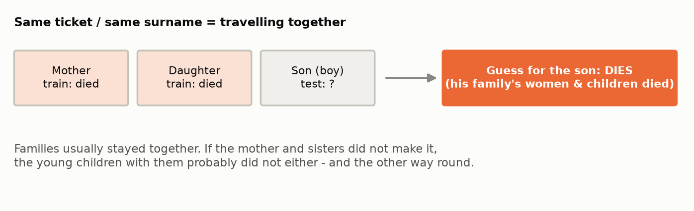

> **Explain like I'm 5:** If you know that everyone in the Smith family who sat at table 7 missed the bus, and there's one more Smith kid at table 7 you don't know about, you'd guess they missed the bus too.

**How we build it:**

1. Group passengers into families using **surname + class + ticket + fare** (and also by **ticket** alone, for friends and servants travelling together).
2. For each passenger, look at the **other women and children** in their group whose answers we know (from the training data).
3. The new clue `GroupRate` is the fraction of them who survived. If there are none, use 0.5 ("don't know").

We only look at **women and children** because adult men mostly died regardless of family, so they tell us little.

### The super-simple "woman-child-group" rule

This idea is so strong that a rule with **no machine learning at all** does very well:

1. Women survive, men die (the gender rule).
2. **Except:** boys (title Master) whose family women and children *all survived* also survive.
3. **Except:** women whose family women and children *all died* also die.

The full code is in `experiments.py` (functions `group_survival` and `wcg_predict`).

> **Important trap: data leakage.** When doing cross-validation with this clue, you must compute `GroupRate` using **only the training piles**, never the quiz pile. Otherwise the model peeks at the quiz answers and your CV score is a lie. `experiments.py` does this correctly by rebuilding the clue inside every fold.

---

## 13. Step 10: Trying different models

A random forest is not the only "brain". We also tried:

| Model | How it thinks (like I'm 5) |
|---|---|
| **Logistic regression** | Gives each clue a number of points ("female: +2, 3rd class: -1") and adds them up. Above a line means "survived". |
| **SVM** (support vector machine) | Draws the widest possible "road" between survivors and non-survivors. |
| **Random forest** | 500 different trees vote. |
| **Gradient boosting** | Builds trees one at a time, where each new tree focuses on fixing the mistakes of the trees before it. Like a student who studies only the questions they got wrong. |
| **Soft-vote ensemble** | Asks all the models above, averages how confident each one is, and goes with the result. A "team of experts". |

Models that need numbers on the same scale (logistic regression, SVM) are wrapped with a `StandardScaler`, which puts every clue on a similar scale so "Fare = 500" doesn't drown out "IsChild = 1".

---

## 14. Results: what actually helped

We tested each improvement with **5-fold cross-validation repeated 5 times** (25 quizzes per model) for reliable scores.

### Adding clues one at a time

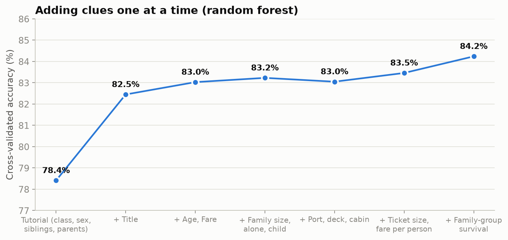

- **Title** was the single biggest win (+4 points). It captures sex *and* age-group in one clue.
- Age, fare and family size helped a little.
- Port, deck and cabin added **nothing**. Not every clue is useful!
- **Family-group survival** gave the next biggest jump.

### Comparing models

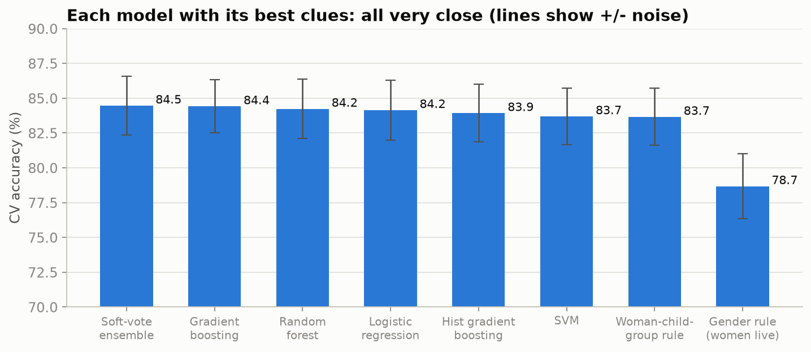

With good clues, **every model scores about the same** (83.7% to 84.5%). The differences are smaller than the noise. **Lesson: better clues matter far more than a fancier model.**

### Summary table

| Approach | CV accuracy | Kaggle score |
|---|---|---|
| Gender rule (women live, men die) | 78.7% | ~0.766 (known) |
| Tutorial random forest | 78.4% | **0.77511** (submitted) |
| Improved RF (title, age, fare, family) | 83.2% | expect ~0.78 |
| Ensemble + family-group survival | 84.5% | expect ~0.78 to 0.80 |
| Woman-child-group rule | 83.7% | often reported ~0.81 |

**Why is the Kaggle score lower than CV?** The test passengers are slightly different from the training ones, and 418 people is a small sample, so luck plays a role. A drop of 2 to 5 points from CV to leaderboard is normal on Titanic.

---

## 15. Common mistakes and how to fix them

| Problem | Cause | Fix |
|---|---|---|
| `FileNotFoundError` | Wrong path to the CSV | On Kaggle use `/kaggle/input/titanic/train.csv`. Locally, check the `data/` folder. |
| `ModuleNotFoundError: No module named 'pandas'` | Library not installed | `python -m pip install pandas scikit-learn` |
| `ValueError: Input contains NaN` | Blank values left in the data | Fill every gap before training (Step 3) |
| `could not convert string to float: 'male'` | Forgot to turn words into numbers | Use `pd.get_dummies` (Step 4) |
| `feature names should match` | Train and test have different columns | `X_test = X_test.reindex(columns=X.columns, fill_value=0)` |
| Kaggle says "submission has wrong number of rows" | Not 418 rows | Predict on `test.csv`, not `train.csv` |
| Great training accuracy, poor Kaggle score | Overfitting | Use cross-validation, and limit `max_depth` |

---

## 16. What to do next

1. **Submit the improved files** from the `submissions/` folder and compare their scores.
2. **Tune the settings** (called *hyperparameters*) with `GridSearchCV`, e.g. try `max_depth` from 3 to 8.
3. **Try XGBoost or LightGBM**, popular gradient boosting libraries.
4. **Read top public notebooks** on the competition's Code tab to see other clever ideas.
5. **Move on** to the next beginner competitions: *House Prices* (predict a number instead of yes/no) and *Spaceship Titanic*.

### Files in this project

```
Titanic/
├── data/                     train.csv, test.csv
├── titanic_model.py          the tutorial model (score 0.77511)
├── titanic_improved.py       + title, age, fare, family features
├── experiments.py            tests every improvement and model, writes submissions/
├── submissions/              ready-to-upload CSV files
└── guide/                    this guide and its diagrams (make_diagrams.py)
```

Run any of them with `python titanic_model.py` from inside the `Titanic` folder.

---

## 17. Glossary

| Term | Plain-English meaning |
|---|---|
| **Accuracy** | Percentage of guesses that were right |
| **Cross-validation (CV)** | Testing a model fairly by hiding part of the training data, quizzing on it, and rotating |
| **CSV** | A simple text file that stores a table, with commas between columns |
| **DataFrame** | pandas' name for a table |
| **Data leakage** | When the model accidentally sees answers it shouldn't, making scores look better than they really are |
| **Decision tree** | A model that asks a series of yes/no questions |
| **Ensemble** | Combining several models and letting them vote |
| **Feature** | A clue / input column given to the model |
| **Feature engineering** | Creating new, smarter clues from the raw data |
| **Fit / training** | Letting the model learn from examples |
| **Hyperparameter** | A setting you choose before training, like `max_depth` |
| **Leaderboard** | Kaggle's ranking of everyone's scores |
| **Median** | The middle value when sorted. Less affected by extreme values than the average |
| **Model** | The thing that learns patterns and makes predictions |
| **One-hot encoding** | Turning a category into several 0/1 columns |
| **Overfitting** | Memorising the training data instead of learning general patterns |
| **Prediction** | The model's guess for a new example |
| **Random forest** | Many decision trees voting together |
| **Target / label** | The answer we want to predict (`Survived`) |
| **Test set** | Data where the answers are hidden; we predict these |
| **Training set** | Data with answers; the model learns from these |

---

*Data: Kaggle "Titanic: Machine Learning from Disaster". Tutorial model based on Alexis Cook's "Titanic Tutorial" notebook on Kaggle. All accuracy numbers in this guide come from running the code in this project.*
